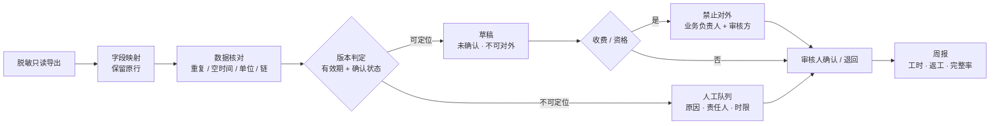

# expo-ticket-trace

**展商咨询工单的版本可追溯只读试点工具**：只读、只出草稿、可审计。

它回答一个具体问题：*这条咨询当时依据的是哪一版规则、由谁确认、哪些还没确认、能不能对外？*

> 项目源自《展商咨询知识与服务转派》需求发现材料（访谈 36/36 覆盖、6 个角色、6 条待验证需求）。
> 材料里的企业与人物均为演练设定，`900 次咨询 / 55% 重复` 是虚构基线，**不是真实经营数据**。

---

## 为什么需要它

现场的三处断点不是“回复慢”，而是**对不上**：

| 断点 | 现场表现 | 后果 |
| --- | --- | --- |
| 时间对不上 | 先用群消息答复，事后补填表格 | 台账时间 ≠ 业务发生时间（f13） |
| 版本对不上 | 问答引用旧通知、旧展位说明 | 时间/费用口径不一致（f10 / f11） |
| 编号对不上 | 服务台、业务台账、文件库各记一段 | 工单无法关联，版本断链（f30） |

文件名里的“最新版”“最终版”不能作为判断依据。这个工具把判定改成**有效期覆盖 + 确认状态 + 作废状态 + 替代链**，并把每一次判断的依据留在运行目录里。

---

## 它做什么 / 不做什么

| 做 | 不做 |
| --- | --- |
| 读取**单批次**脱敏只读导出，保留原始行 | 不写回任何源系统，不提供写接口 |
| 标注“当前 / 过期 / 未确认”，列出判定依据与已排除版本 | 不回答展商问题，不生成对外承诺 |
| 组装带来源、行号、版本的回复**草稿**，固定“未确认 · 不可对外” | 不自动发布、不发外部消息 |
| 把无法确认的工单连同原因、责任人、时限放进人工队列 | 不默认通过、不猜版本、不悄悄重试 |
| 记录确认项与审计哈希链，输出三项并列指标 | 不判断业务对错，不替代审批 |
| 读取失败时用上次快照续跑，并标注快照时间 | 不编造缺失数据 |

收费、报价、退款、参展资格属于**不可逆边界**：草稿会被标记为禁止直接对外，必须由业务负责人与审核方确认。

---

## 60 秒上手

要求 Python **3.11+**，运行时**零第三方依赖**。

```bash
git clone <your-repo-url> expo-ticket-trace
cd expo-ticket-trace

# 方式一：免安装（推荐先试）
PYTHONPATH=src python -m expo_trace run

# 方式二：安装命令行入口（需要本机有 setuptools；无网络也可用方式一）
pip install -e .
expo-trace run
```

Windows PowerShell：

```powershell
$env:PYTHONPATH="src"; python -m expo_trace run --run-dir runs/demo --now "2026-10-20 10:00"
```

真实输出（演示数据，固定运行时间）：

```text
运行目录：runs/demo
输入：5 个文件（sha256 已记录）
降级：否
工单：16  可出草稿：5  人工队列：9  阻塞：2
问题：14（error 12 / warn 2）
指标：工时 452 分钟 · 返工 0 次 · 确认完整率 0.0%
验收（工具侧）：工具侧覆盖 6/6；业务验收未执行（80 条抽查为人工动作）
产物：runs/demo/output/report.md
```

打开 `runs/demo/output/report.md` 看周报，`runs/demo/output/checklist.md` 看一线缺项清单，
`runs/demo/output/queue.csv` 看转派队列，`runs/demo/output/drafts/` 看每张草稿。

> 16 张工单里有 12 个**故意埋的坑**（重复编号、空时间、版本冲突、替代链断、跨批次授权、回填时间、单位混用、文件名陷阱等），
> 用于验证“失败封闭”。说明见 [`data/demo/README.md`](data/demo/README.md)。

---

## 六个需求怎么落到代码里

| 需求 | 实现 | 测试 |
| --- | --- | --- |
| **REQ-1** 有效期 + 确认状态替代文件名 | `core/versioning.py` 排序键只含 confirmed / void / effective_from / confirmed_at / received_at / version_id；不读文件名与 mtime | `test_versioning.py`（含“最新版”陷阱） |
| **REQ-2** 交接点统一编号与责任清单 | 别名映射 + `raw` 原行保留；重复编号、空时间、链断、单位差异逐条入 `issues` | `test_ingest.py`、`test_validation.py` |
| **REQ-3** 双时间戳 + 快照兜底 | `Ticket.occurred` / `received` 四态；回填超阈值单独标记；读取失败加载上次快照并标注时间 | `test_timeutil.py`、`test_ingest.py` |
| **REQ-4** 兜底触发进队列，不默认通过 | `core/routing.py` 断言每条工单都有分派；阻塞问题全部进队列 | `test_routing.py`、`test_validation.py` |
| **REQ-5** 工时 / 返工 / 确认完整率并列 | `core/metrics.py` 三项同时输出并写公式；报告不提供单一效率结论 | `test_metrics.py` |
| **REQ-6** 只出草稿、不自动发布收费或资格决定 | `core/drafting.py` 固定水印 + 收费/资格阻塞；`publish()` 恒抛 `BlockedAction`；配置校验拒绝开启写回 | `test_drafting.py`、`test_review.py`、`test_config.py` |

逐条追溯（原文、证据编号、残余风险）见 [`docs/requirements-traceability.md`](docs/requirements-traceability.md)。

---

## 流程图

- [`docs/flowchart.md`](docs/flowchart.md)：5 张 Mermaid 图（GitHub 直接渲染）
  1. 现状链路与三处断点
  2. 目标流水线：只读、只出草稿、失败进队列
  3. 版本判定决策树
  4. 工单状态机
  5. 数据流与审计链
- [`docs/flowchart.html`](docs/flowchart.html)：同一内容的离线可视化版本，无外部依赖，可直接打印。


---

## 设计方案（v1）

[`docs/solution-v1/`](docs/solution-v1/README.md) 是面向业务与采购的一套完整交付：业务挖掘报告、行业分析、两张流程图（现状 / 数智化转型后）、总体架构图、报价单与设计方案。文档中的案例、人物和数字均为合成样本，行业统计仅引用可核查的公开来源。

| 文件 | 内容 |
| --- | --- |
| [01-业务挖掘报告.docx](docs/solution-v1/01-业务挖掘报告.docx) | 36 条访谈事实、六角色权责、八环节断点、六条需求假设与证据缺口 |
| [02-行业分析.docx](docs/solution-v1/02-行业分析.docx) | 会展行业边界、数字化成熟度、技术趋势、合规约束与对本方案的启示 |
| [03-流程图说明.docx](docs/solution-v1/03-流程图说明.docx) | 现状流程图、数智化转型后流程图、总体架构图与逐图说明 |
| [04-报价单.xlsx](docs/solution-v1/04-报价单.xlsx) | 7 项交付、26 人天工作分解、税率与付款节奏、假设与不含项 |
| [05-设计方案.docx](docs/solution-v1/05-设计方案.docx) | 目标、架构、数据与功能设计、安全、实施计划、验收与风险 |
| [03-图表/](docs/solution-v1/03-图表) | 三张 1700px 宽的 PNG 原图，可直接插入汇报材料 |

---

## 架构方案（v2）：报销助手智能体

[`docs/architecture-v2/`](docs/architecture-v2/README.md) 是另一份独立的架构选型文档，主题是**报销助手智能体系统**（FastAPI 异步后端、LLM 经 API 接入且可替换、制度文档向量化检索、员工/管理员两角色），与本仓库的展商工单工具没有代码依赖。

| 文件 | 内容 |
| --- | --- |
| [01-架构选型方案.docx](docs/architecture-v2/01-架构选型方案.docx) | 四层架构、目录 tree、5 张核心表 + 5 张支撑表、第一周 MVP、选型对比与风险 |
| [02-图表/四层架构图.png](docs/architecture-v2/02-图表/四层架构图.png) | 1700×1320 PNG：入口层 / 服务层 / 智能体编排层 / 数据模型层 + 请求路径与两条红线 |

核心取舍：**判定与生成分离**（版本与适用性用 SQL/规则判定）、**先过滤再相似**（`status=active` + 生效区间先过滤，再向量召回）、**工具即权限边界**（注册表里没有提交报销单的工具）、**回答可回放**（引用、提示词版本、模型与用量随消息落库）。

---

## 裸问答原型（v3）

[`src/rag_qa.py`](src/rag_qa.py) 是阶段 1 的单文件实现：读 `data/policy/报销制度.md` → 结构感知切片（500 字 / 80 重叠）→ 向量化 → FAISS（可选）或 numpy 索引 → BM25 + 向量混合检索 top3 → 拼提示词 → 调用可配置的 LLM，回答带 `[编号]` 引用，没有依据时直接拒答。

```bash
python -m pip install numpy
python src/rag_qa.py --selftest                  # 29 项离线自检
python src/rag_qa.py -q "出差住宿标准是多少？"      # mock 模式，只看链路
python src/rag_qa.py -q "发票丢了怎么办？" --provider deepseek
```

`call_llm()` 走 OpenAI 兼容协议，`openai / deepseek / ollama / mock` 四选一；切片、嵌入、混合检索、提示词与拒答判据都标了 `[核心·阶段2复用]`，可直接搬进 FastAPI 服务。详细说明见 [docs/rag-prototype.md](docs/rag-prototype.md)。
---

## 命令行

| 命令 | 用途 |
| --- | --- |
| `expo-trace run` | 跑完整流水线，生成周报、队列、草稿、审计记录 |
| `expo-trace status` | 查看运行状态与人工确认进度 |
| `expo-trace review --ticket T-1001 --reviewer 傅景 --decision confirm --item ...` | 提交人工确认/退回 |
| `expo-trace feedback --ticket T-1005 --kind 误报 --reporter 傅景 --note ...` | 登记误报/漏报/未确认，进入周报与审计 |
| `expo-trace pause / resume --actor 傅景` | 审核方暂停 / 恢复试点 |
| `expo-trace report` | 基于运行目录重跑并更新周报（不改输入） |
| `expo-trace audit verify` | 校验审计哈希链，定位断点 |
| `expo-trace audit show --ticket T-1001` | 查看谁查过、用哪版、谁确认 |
| `expo-trace sample --size 80` | 生成确定性抽查计划 |

退出码：`0` 成功 · `2` 输入/配置错误 · `3` 试点已暂停 · `4` 确认被拒绝 · `5` 已阻止的越界动作。
完整参数与产物 schema 见 [`docs/api.md`](docs/api.md)。

---

## 仓库结构

```text
expo-ticket-trace/
├── README.md                     # 本文件
├── LICENSE                       # MIT（纯许可证文本，便于 GitHub 识别）
├── NOTICE                        # 数据为合成样本的声明
├── .gitignore
├── CHANGELOG.md
├── CONTRIBUTING.md
├── SECURITY.md                   # 安全模型、已知风险、事件处置
├── requirements.txt              # 运行时零依赖；开发工具可选
├── pyproject.toml                # 打包与 expo-trace 入口
├── src/
│   ├── expo_trace/               # 展商工单工具（包）
│   ├── rag_qa.py                 # 报销制度裸问答原型（单文件，可直接运行）
│   └── expo_trace/__init__.py
│   ├── main.py                   # CLI 入口
│   ├── core/                     # ingest / versioning / validation /
│   │                             # routing / drafting / review /
│   │                             # metrics / acceptance / report / audit
│   └── utils/                    # YAML 子集、时间四态、脱敏、哈希
├── docs/
│   ├── design.md                 # 设计思路与取舍
│   ├── api.md                    # CLI / Python API / 产物 schema
│   ├── flowchart.md              # 5 张 Mermaid 流程图
│   ├── flowchart.html            # 离线可视化版本
│   ├── pilot-runbook.md          # 四周试点手册（2 人 / 每周 ≤4h）
│   ├── requirements-traceability.md
│   ├── rag-prototype.md          # v3 原型说明（原 v3-裸问答原型/README.md）
│   ├── solution-v1/              # v1 交付：业务挖掘 / 行业分析 / 流程图 / 报价单 / 方案
│   └── architecture-v2/          # v2 交付：报销助手四层架构选型
├── tests/                        # 103 项 unittest，与 core 模块对应
├── examples/demo.py              # 跑得起来的分步演示
├── scripts/                      # build.sh / deploy.sh / verify.sh
├── config/default.yaml           # 非机密默认配置
├── data/
│   ├── demo/export/              # 12 个坑的合成样本
│   └── policy/报销制度.md         # v3 原型的合成制度原文
└── .github/                      # CI、Issue 模板、PR 模板
```

> 目录对应需求方给的模板（`my-tool/` → `expo-ticket-trace/`、`my_tool/` → `expo_trace/`），
> 并补充了 `pyproject.toml` 与追溯/手册文档。

### 交付物放在哪（整合说明）

三批文档与代码没有覆盖 `src/expo_trace/` 的任何核心文件，只按“代码进 `src/`、脚本/示例进 `examples/`、文档进 `docs/`、样例数据进 `data/`”归位：

| 原位置 | 现位置 | 说明 |
| --- | --- | --- |
| `v1设计方案/` | `docs/solution-v1/` | 5 份 Word/Excel + 3 张 PNG，内部相对链接已随之生效 |
| `v2-报销助手架构方案/` | `docs/architecture-v2/` | 架构选型 docx + 架构图 |
| `v3-裸问答原型/rag_qa.py` | `src/rag_qa.py` | 单文件原型，默认路径改为仓库根下的 `data/policy/` 与 `.rag-index/` |
| `v3-裸问答原型/data/报销制度.md` | `data/policy/报销制度.md` | 合成制度原文 |
| `v3-裸问答原型/README.md` | `docs/rag-prototype.md` | 命令示例改为从仓库根运行 |

被更新的既有文件只有 3 个：`README.md`（本章节与结构树）、`CHANGELOG.md`（路径与整合记录）、`.gitignore`（索引目录）。
>
> 仓库根目录另有一个与本工具无关的历史文件 `报销助手_f24011321.zip`（仓库原有内容，保留未删）。

---

## 配置

`config/default.yaml` 是非机密默认配置，关键项：

| 键 | 含义 |
| --- | --- |
| `pilot.batch` | 只处理这一个批次（默认 `2026-S1`） |
| `safety.read_only` / `draft_only` | 必须为 `true`，否则拒绝启动 |
| `safety.auto_publish` / `write_back` / `external_message` | 必须为 `false` |
| `safety.watermark` | 草稿固定标识“未确认 · 不可对外” |
| `quality.backfill_hours` | 回填时间差阈值（默认 8 小时） |
| `quality.sample_size` | 抽查量（默认 80，正式是否沿用需审批） |
| `routing.sla_hours` / `owners` | 队列时限与责任人映射 |
| `review.reviewers` / `pause_roles` | 可确认人员 / 可暂停试点的审核方 |

配置里**没有**“允许自动发布”的开关；即使手工改成 `true`，`Config.validate()` 也会拒绝启动。

---

## 试点与验收

- 预算：**4 周、2 名业务骨干、每周 ≤4 小时**；超出即重新评估（f03）。
- 工具侧验收：`expo-trace run --strict`，6 条需求的工具侧检查全过才返回 0。
- 业务侧验收：**未执行**。80 条问答抽查、旧版本占比、检索耗时、快照保留期、例外认定权仍需真实试点核实。
- 每周复盘三项指标 + 误报/漏报/未确认项；周报不得只报工时（f51 / f55）。误报/漏报用 `expo-trace feedback` 登记，进入周报与审计链。
- 审核方保留随时暂停权（f04）。

操作步骤见 [`docs/pilot-runbook.md`](docs/pilot-runbook.md)。

---

## 开发

```bash
python -m unittest discover -s tests -t .    # 103 项，零依赖
python -m compileall -q src
python examples/demo.py                       # 分步演示（含确认、暂停、快照兜底）
```

- 代码风格：`ruff`（line-length 100），中文 docstring；
- 提交前请确认没有新增“写回 / 自动发布 / 外部消息”代码路径；
- 判定规则改动必须同时补测试与 `CHANGELOG.md`。

贡献方式见 [`CONTRIBUTING.md`](CONTRIBUTING.md)。

---

## 数据与合规

- `data/` 下全部为**合成样本**，不对应任何真实展会、企业或个人信息；手机号、邮箱、证件号在进入运行目录前已掩码。
- 工具只读取脱敏只读导出；不连接生产库、不调用外部模型、不发送任何网络请求。
- 若用于真实数据，请先确认授权范围、保存期限与审计取证要求（f32 / f43 / f45）。

## 许可证

[MIT](LICENSE)。`data/` 为合成样本，随仓库一并按 MIT 提供。
