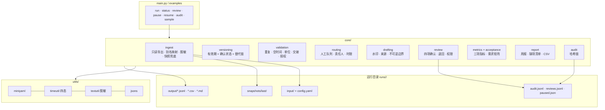

# 设计说明

本文说明 `expo-ticket-trace` 为什么这样设计、边界在哪里、哪些结论还没有证据。
逐条需求的实现与验收对照见 [`requirements-traceability.md`](requirements-traceability.md)。

---

## 1. 问题定义

需求发现材料里的 62 条访谈记录指向同一个结构性问题：

> 答复是先发生的，记录是后补的；三套系统各记一段；判断“哪一版有效”靠文件名和记忆。

于是出现三类可观察的后果：

1. **时间失真**：回填时间被当成业务发生时间（f13），后续所有“多久回复”的统计都不可信。
2. **版本失真**：旧通知、旧展位说明被继续引用（f10 / f11），时间与费用口径不一致。
3. **责任失真**：工单没有统一关联编号（f30），交接只留一句“已处理”，版本断链后无法追溯。

因此工具的目标不是“更快地回答展商”，而是**把一次答复所依据的版本、确认状态和来源固定下来**，让复核与审计有据可查。这也是 REQ-1～REQ-6 的共同前提。

### 明确的非目标

| 非目标 | 原因 |
| --- | --- |
| 自动回复展商 | REQ-6：只出草稿，不自动发布；收费/资格决定不可逆 |
| 判断业务口径对错 | 工具只核对“依据哪一版”，不替代业务负责人判断 |
| 做知识检索/向量库 | 现场问题不是“找不到文档”，而是“找到了却不知道是哪一版、谁确认的” |
| 提升回复速度 | 验收明确“不预设效率提升”（REQ-1 验收原文） |
| 连接生产系统 | 只读脱敏导出；写回/外部消息接口不开放（f32） |

---

## 2. 设计原则

1. **失败封闭**：无法确认版本、关键字段缺失、来源不完整、授权不清 → 一律进人工队列，绝不默认通过（f44）。
2. **只读优先**：运行目录是唯一写入点；源系统、对外消息、写回接口全部不提供。
3. **可复现**：任何命令都从运行目录里持久化的输入与配置副本重新计算，而不是在快照 JSON 上打补丁。
4. **缺失 ≠ 未确认**：空值、`未确认`、格式非法是三种不同状态，分别进入不同问题代码。
5. **判定依据可解释**：每个 `resolution` 都记录排序键、已排除版本与排除理由。
6. **指标并列**：工时、返工、确认完整率三项同时呈现，禁止单一效率结论（f51）。
7. **审计不可静默**：每个动作追加哈希链记录；校验能定位到具体断点（f45）。

---

## 3. 架构



模块职责：

| 模块 | 职责 | 关键约束 |
| --- | --- | --- |
| `core/ingest.py` | 读取 4 张导出表 + manifest，别名映射，个人字段掩码，保留原行 | 读取失败只走快照，不重试、不补值 |
| `core/versioning.py` | 判定当前版本 | 排序键不含文件名/mtime |
| `core/validation.py` | 产出可定位到行的问题记录 | 每条问题带 `source` / `line` / `raw` |
| `core/routing.py` | 分派草稿/队列/阻塞，给责任人与时限 | 断言无工单被静默跳过 |
| `core/drafting.py` | 组装草稿，水印与边界检查 | `publish()` 恒抛异常 |
| `core/review.py` | 人工确认/退回 | 四项确认齐全、权限校验、去重 |
| `core/metrics.py` | 三项指标与确定性抽样 | 公式写入输出，避免口径漂移 |
| `core/acceptance.py` | 6 条需求的工具侧自检 | 业务验收恒为 `NOT_RUN` |
| `core/report.py` | 周报、缺项清单、CSV | 不隐藏降级/暂停状态 |
| `core/audit.py` | 追加与校验哈希链 | 改一行即可定位断点 |

---

## 4. 关键机制

### 4.1 版本判定：为什么文件名必须出局

现场最直觉的做法是“取文件名里带最新/最终的那份”。这在本案例里会直接出错：

- `最新版_展位说明_最终版.pdf`（V-1012）是**后到的未确认**版本，且不覆盖业务发生时间；
- 真正有效的是 `V-1002`（有效期覆盖、已确认）；
- 另有 `V-1008` 与 `V-1011` 都“已确认”且都覆盖同一天，属于**真冲突**，不能猜。

排序键（`core/versioning.py`）：

```text
(confirmed, not void, effective_from, confirmed_at, received_at, version_id)
```

- 先看是否确认；未确认永远排在已确认之后，**后到也不能覆盖**（f34）。
- 作废版本保留原因，但退出当前版本竞争（f24）。
- 有效期不覆盖业务发生时间的版本不参与判定，只作为“已排除”记录展示。
- 替代链（`supersedes`）存在时取链上后继；链断 → `VERSION_CHAIN_BREAK`，进队列。
- 多个已确认版本互不替代 → `VERSION_CONFLICT`，进队列。

草稿会列出“已排除的版本”及理由，审核人能看到工具**没有**选谁、为什么。

### 4.2 双时间戳与回填

每张工单保留两个时间：

- `occurred`：业务发生时间，版本判定的时点；
- `received`：系统接收/登记时间，仅用于计算回填差与运营统计。

两者都是四态：`ok / missing / unconfirmed / invalid`。

- 缺失 → `TIME_MISSING`；
- 写明“未确认/待核实” → `TIME_UNCONFIRMED`；
- 格式非法 → `TIME_INVALID`；
- 接收 − 发生 > `quality.backfill_hours`（默认 8h）→ `BACKFILLED_TIME`，该样本从“干净工时”中排除，但仍计入总数并单独标注。

版本判定使用 `occurred`；缺失时**不退回**用 `received` 顶替，而是进队列（否则等于把回填时间当成事实）。

### 4.3 快照兜底

读取导出失败（文件缺失、编码错误、清单不可读）时：

1. 不做任何“修复性猜测”，不静默重试；
2. 从 `snapshots/last/` 读取上一次成功运行的原始导出文本；
3. 在报告与清单里标注快照时间、降级原因，并提示人工核查（f35）；
4. 审计记录 `degraded=true`，复现命令仍指向原导出目录。

快照存的是**原始文本**而不是规范化对象，保证重放走同一条解析路径。

### 4.4 不可逆边界

`config/default.yaml` 里：

```yaml
safety:
  read_only: true          # 必须
  draft_only: true         # 必须
  auto_publish: false      # 必须
  write_back: false        # 必须
  external_message: false  # 必须
```

`Config.validate()` 在启动时检查；任何一项被改成越界值都会 `ConfigError` 拒绝启动。
草稿正文按类别/关键词检测收费、报价、退款、资格等，命中即 `BLOCKED`，并写明“不得自动对外”。
`drafting.publish()` / `send_external()` / `write_back()` 恒抛 `BlockedAction`（退出码 5），代码里不存在可用的发送路径。

### 4.5 人工确认

确认不是“点通过”，而是对四项逐条确认：

1. 版本可定位；
2. 来源可追溯；
3. 未确认项已列明；
4. 用途与授权范围相符。

- 缺任一项 → 拒绝（`ReviewRejected`，退出码 4）；
- 收费/资格类只能由 `safety.irreversible_reviewers` 中的人确认；
- 无版本可定位的工单不能确认；
- 退回必须写原因（≥4 字），计入返工；
- 同一时刻重复提交同一工单会被去重拒绝。

确认记录包含 `draft_digest`（草稿正文哈希），确保“确认的是这一版草稿”。

### 4.6 三项指标

| 指标 | 公式 | 防滥用 |
| --- | --- | --- |
| 处理工时 | Σ 台账处理时长（统一分钟）；回填样本单列，不混入干净口径 | 不能单独作为效果结论 |
| 返工次数 | 退回次数 + 同一工单重复确认次数 | 少报返工即失真 |
| 确认完整率 | 已确认必确认项 ÷（工单数 × 每单必确认项数） | 未确认不能算完成 |

报告固定并列输出，并写明公式；`acceptance` 会检查三项是否同时存在。

### 4.7 审计链

每条记录：

```json
{"seq": 3, "at": "2026-10-20T10:00:00+08:00", "actor": "傅景",
 "action": "review_submitted", "subject": "T-1001",
 "details": {"decision": "confirm", "items": ["版本可定位", "..."]},
 "prev": "<上一条 hash>", "hash": "<sha256(prev + 规范化 JSON)>"}
```

`audit verify` 逐条重算并比对 `prev`，返回第一个断点的 `seq`，而不是笼统的“校验失败”。

每次运行还会为**每张工单**写一条 `version_resolved`（`state` / `version_id` / `reason_code`），
因此“当时用的是哪一版、为什么”不依赖最终报告；`audit show --ticket` 查看单张工单时，
会追加一条 `audit_viewed`（谁、何时、看了哪张），满足 f45 对“谁查过”的要求。

---

## 5. 关键取舍

| 取舍 | 选择 | 理由 |
| --- | --- | --- |
| 依赖 | 只用标准库 | 审计类工具应缩小供应链与权限面；也便于在受限环境运行 |
| 配置格式 | YAML 子集 + 自写解析器 | 避免引入 PyYAML；解析器对 Tab/重复键/列表套映射显式报错 |
| 运行模型 | 重跑式（run 目录持久化输入） | 避免 JSON→对象反序列化带来的隐性漂移；任何命令都能从输入复算 |
| 草稿生成 | 模板 + 规则，不调用模型 | 不能编造口径；草稿只组装“可追溯事实 + 未确认项” |
| 冲突处理 | 进队列，不猜 | 猜错一次的代价是错误对外口径（不可逆） |
| 指标 | 三项并列 | 单一工时会被用来证明“提效”，掩盖返工与未确认（f51） |
| 失败 | 封闭 | 读取失败/版本断链时“停下来”比“尽量给个结果”更符合审计要求 |

---

## 6. 已知限制与未验证项

- **数据是合成的**：16 张工单、12 个版本都是演练样本；`f12` 的 900 次/55% 是虚构基线。
- **80 条抽查未执行**：工具只生成确定性抽样计划；业务验收仍为 `NOT_RUN`。
- **旧版本实际占比、检索耗时、快照保留期限、例外认定权归属**均未核实。
- **单位归一只覆盖时长与常见中文单位**；金额、汇率等未实现。
- **不处理跨批次**：manifest 授权范围外的批次直接拒绝（当前仅 `2026-S1`）。
- **审计链防篡改但不防删除整段**：需要配合外部留存/备份策略（保存期未定）。
- **确认完整率依赖人工如实提交**；工具无法验证“人是否真的看过”。

这些限制不是待办清单的装饰：在真实试点前，它们需要被逐条确认或写进试点的停止条件。
