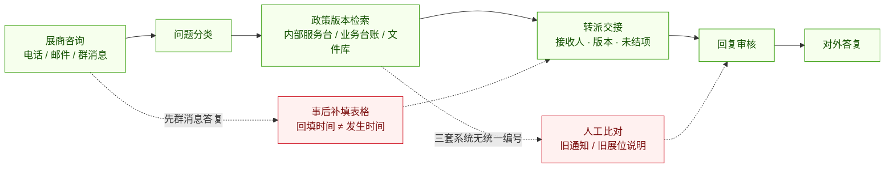
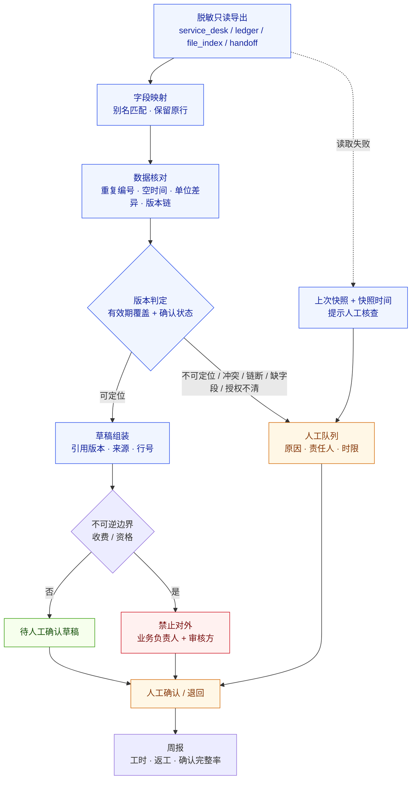
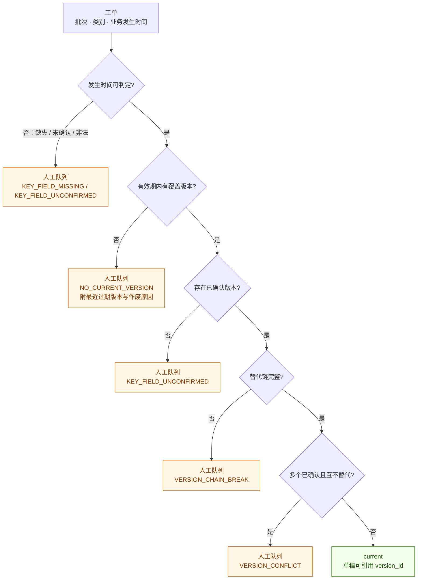
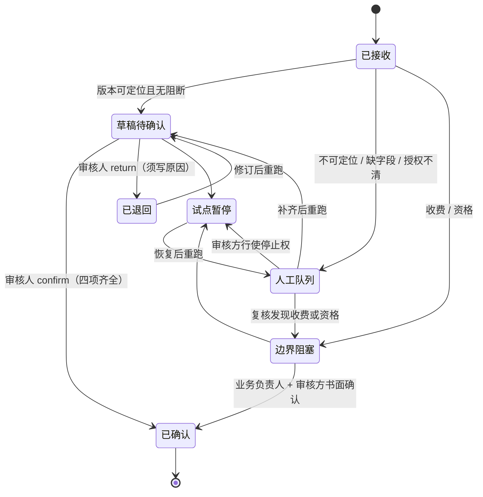
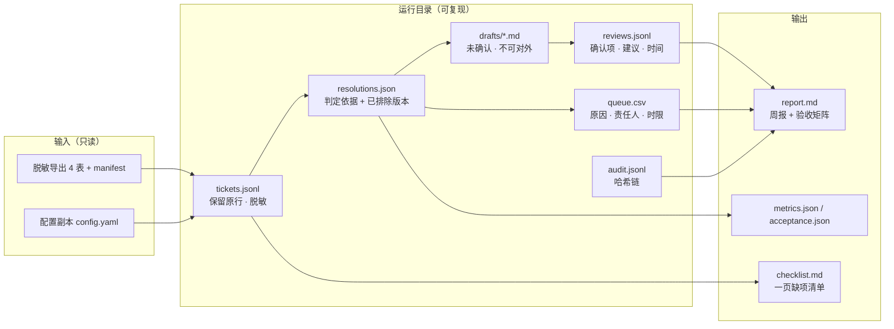

# 流程图：从现场链路到只读追溯

本页把《展商咨询知识与服务转派》需求发现材料里的业务链路、断点、目标流程、版本判定与审计链画成 5 张图。
图源是 Mermaid，GitHub 会直接渲染；同内容的可视化版本见 [`flowchart.html`](flowchart.html)（离线可开，无外部依赖）。

> 材料性质：访谈与数据均为合成演练样本，人物为虚构角色，`900 次咨询 / 55% 重复` 是虚构基线，不能当作真实单量或效果承诺。

---

## 图 1　现状链路与三处断点

**读图要点**

- 答复动作（A→G）发生在登记（G→D）之前，所以台账里的“接收时间”只是回填时间，不能当业务发生时间（f13）。
- 检索横跨三套系统，工单没有统一关联编号，交接时只能人工比对（f30）。
- 旧通知、旧展位说明仍在被引用，文件名看起来“最新”不代表有效（f10 / f11）。

---

## 图 2　目标流水线：只读、只出草稿、失败进队列

**读图要点**

- 只有两条出口：**可出草稿**或**带原因进队列**；收费/资格再叠一层“禁止对外”。没有“默认通过”的边（f44）。
- 读取失败不允许编造，也不允许悄悄重试：用上次成功快照续跑，并在报告里标注快照时间与“需人工核查”（f35 / REQ-3）。
- 草稿不是答复：它是把“依据哪一版、谁确认、哪些还没确认”摆到审核人面前（f22 / f42）。

---

## 图 3　版本判定：为什么文件名不参与排序

**读图要点**

- 判定只使用：**有效期是否覆盖业务发生时间** + **是否已确认**；排序键里没有文件名、没有修改时间、没有“看起来最新”。
- 作废的版本不删除，保留作废原因，只退出“当前版本”的竞争（f24）。
- 多个“已确认”版本同时覆盖同一天、又互不替代时，工具**不猜**，进冲突队列（f34）。
- 替代链断掉（`supersedes` 指向不存在的版本）时同样进队列，版本链不能断（f43）。

---

## 图 4　工单状态机：确认、退回与暂停

**读图要点**

- `confirm` 不是点一下通过：必须覆盖配置里的四项确认（版本可定位、来源可追溯、未确认项已列明、用途与授权范围相符）。
- `return` 必须写原因（≥4 字），并计入返工次数。
- 暂停是**审核方的权限**，不是系统管理员的开关；暂停期间不生成任何草稿（f04）。

---

## 图 5　数据流与审计链：谁查过、用哪版、谁确认

**读图要点**

- 每条审计记录都带前一条的哈希：改一行，后续全部对不上，`expo-trace audit verify` 能定位到断点（f45）。
- 确认记录保留“提了什么建议、确认了哪几项、什么时候”，不是只留一句“已处理”（f45 / f43）。
- 原始行、原始版本、作废原因都留在运行目录里；只对个人字段做掩码，不改变业务字段（f43）。

---

## 图与需求的对应

| 图 | 回答的问题 | 对应需求 / 证据 |
| --- | --- | --- |
| 图 1 | 现在为什么会对不上？ | f10 / f11 / f13 / f30 |
| 图 2 | 工具在这条链路里做什么、不做什么？ | REQ-4、REQ-6；f32 / f44 / f52 |
| 图 3 | 凭什么说这一版是“当前版本”？ | REQ-1、REQ-2、REQ-3；f24 / f34 / f43 |
| 图 4 | 草稿怎么才算确认，谁能停？ | REQ-6；f04 / f22 / f42 |
| 图 5 | 出了争议怎么复原？ | f45；审计与留存要求 |

> 这些图描述的是**工具侧能力**，不等于业务验收通过。80 条问答抽查、旧版本占比、快照保留期等仍需在真实试点中核实（见 `docs/pilot-runbook.md`）。
