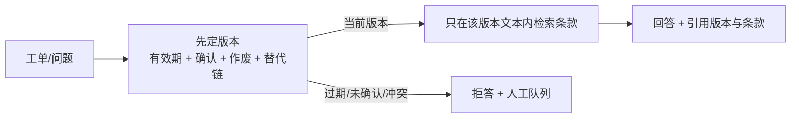
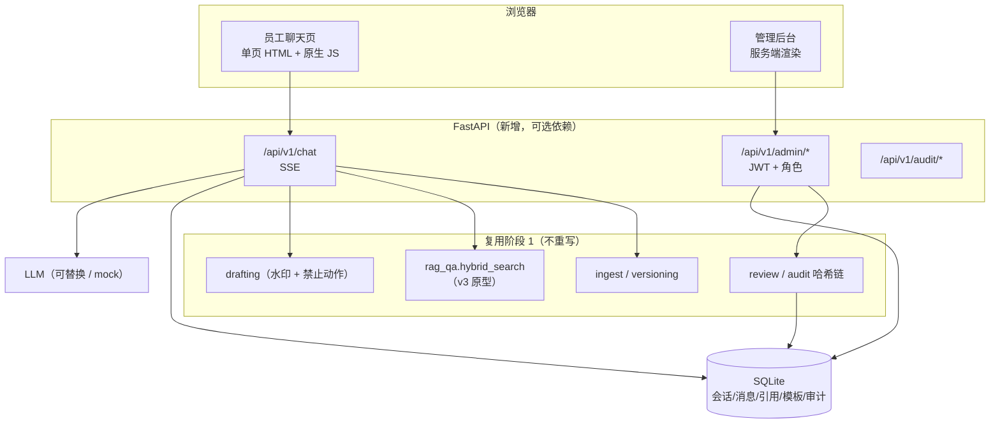

# 阶段 2 设计：会话入口、管理后台、Agent 工具（展商咨询版）

本目录回应三份提示词（外部模板）。**对象已替换为本项目：展商咨询工单的版本可追溯助手**。
三份设计已按 P1–P4 落地，实现见 `src/expo_trace/web/`，状态见第 9 节。

---

## 0. 先确认：本项目没有被提示词带跑

本项目的主线来自《展商咨询知识与服务转派》需求发现材料里的工单追溯问题。证据在仓库里：

| 证据 | 位置 | 说明 |
| --- | --- | --- |
| 项目定位 | `README.md:3-8` | "展商咨询工单的版本可追溯只读试点工具"，数据来自 36/36 访谈与 6 条需求 |
| 数据与埋坑 | `data/demo/export/`、`data/demo/README.md` | 16 张展商咨询工单、12 个故意埋的坑（重复编号、版本冲突、回填时间等） |
| 需求对照 | `docs/requirements-traceability.md` | REQ-1～REQ-6 与 f 码、测试文件一一对应 |
| 代码 | `src/expo_trace/` | 版本判定、双时间戳、草稿水印、审计哈希链 |

`docs/architecture-v2/` 里的四层架构选型描述的是**同一项目**（展商咨询工单助手）的技术底座：FastAPI 异步后端、LLM 可替换、规则文档向量化检索。它给的是选型与取舍，本目录给的是接口与页面契约，两者互补。
本次把提示词 4/5/6 的模板对象逐项替换为本项目对象，见下表。

---

## 1. 术语替换表

| 提示词原文 | 本项目对应物 | 说明 |
| --- | --- | --- |
| 通用问答助手（模板原对象） | 展商咨询工单助手 | 面向内部人员，不直接面向展商 |
| 员工端 | 一线服务专员、项目流程协调员 | 林亦舟、唐映秋 |
| 管理员 | 审核与质量负责人（业务）、数字化工程师（系统） | 傅景、秦芮；职责分离，不合并成一个"超级管理员" |
| 制度/规则原文（模板原对象） | 展会通知与规则版本（含有效期、确认状态、作废原因、替代链） | 版本是核心对象，不只是文档 |
| 申请单（模板原对象） | 回复草稿 / 交接单 | 草稿固定水印，不可直接外发 |
| 票据校验（模板原对象） | 版本与关键字段校验 | 校验"依据哪一版、字段是否齐全"，不校验票据真伪 |
| 提交申请（模板原对象） | 人工对外回复 | 系统不提供任何发送通道（REQ-6） |
| 疑似违规问答（模板原对象） | 疑似越权承诺：收费、报价、退款、参展资格、折扣 | 不可逆边界，必须两名授权人 |
| 制度条文引用 | 版本号 + 通知编号 + 条款/章节 + 有效期 + 确认人 | 引用必须能回到版本，不只回到文件 |
| 对话审计 | 工单答复审计 | 谁问、依据哪版、生成了什么草稿、谁确认 |

---

## 2. 三份设计

| 文件 | 对应提示词 | 内容 | 状态 |
| --- | --- | --- | --- |
| [`chat-api.md`](chat-api.md) | 4 员工问答入口 | SSE 接口、SQLite 会话表、最近 6 轮、前端状态机与引用卡 | 设计待确认 |
| [`admin-console.md`](admin-console.md) | 5 管理后台 | 7 个页面、接口清单、JWT 与角色矩阵、知识库与提示词模板 | 设计待确认 |
| [`agent-tools.md`](agent-tools.md) | 6 Agent 工具 | 10 个 Function Calling 工具、调用顺序、`context_token` 机制、系统提示词约束 | 设计待确认 |

三份设计对应的实现已落地（见第 9 节）；落地批次与工作量见第 7 节。

---

## 3. 共同边界（不可谈判，继承 REQ-6）

1. **不自动对外**：没有 `send` / `publish` / `webhook` 接口；聊天回答只是草稿素材。
2. **不决定收费与资格**：命中收费、报价、折扣、退款、参展资格、押金 → 回答必须转为"需授权人确认"，不给结论。
3. **只读源系统**：知识库写入只发生在本地库；不写回服务台、台账、文件库。
4. **无引用不回答**：检索不到、版本未确认、字段缺失 → 明确说"无法确认"，并给人工入口。
5. **暂停权在审核方**：任一接口在试点暂停时返回 `E_PILOT_PAUSED`，不降级放行。
6. **全链路留痕**：会话、检索、工具调用、草稿、确认都进审计链，可定位断点。

阶段 2 新增两条：

7. 检索**只能**在"候选版本"内进行，检索结果不能反过来创造或提升版本效力。
8. 会话历史只用于理解追问，**不作为事实依据**；事实必须来自本轮引用。

---

## 4. 为什么阶段 1 说"不做向量检索"，阶段 2 又做

`docs/design.md:28` 把"做知识检索/向量库"列为非目标，理由是：现场瓶颈不是找不到文档，而是找到了却不知道是哪一版、谁确认的。

阶段 2 做检索，但顺序是反的：

**版本判定是闸门，检索只是取文本。** 这样既补上"找条文"的效率，又不会退回到"文件名当版本"的老问题。
如果先检索再猜版本，等于把阶段 1 修掉的坑重新挖开。

---

## 5. 架构总览

部署形态仍是**单机**：一个进程、一个 SQLite 文件、一个 `.rag-index/` 目录；不出网（LLM 除外），不接生产系统。

---

## 6. 复用与新增

| 复用（不改语义） | 新增 |
| --- | --- |
| `core/versioning.py` 判定排序与 `considered` 证据 | `api/`（FastAPI 路由、SSE、错误处理） |
| `core/drafting.py` 水印、禁止动作、`publish` 恒抛 | `web/`（聊天页、后台模板） |
| `core/review.py` 四项确认 | `db.py`（SQLite 连接、迁移、审计链） |
| `core/audit.py` 哈希链格式 | `prompts` 表（模板版本与发布） |
| `src/rag_qa.py` 切片、BM25+向量、拒答 | `context_token`（防跳步，见 agent-tools） |

**不新增**：任何外发通道、任何写回源系统的接口、任何"自动通过"开关。

---

## 7. 确认后的落地顺序

| 批次 | 内容 | 预估 | 验收 |
| --- | --- | --- | --- |
| P1 | `/chat` SSE + SQLite + 聊天页 | 1.5 人天 | 断线重连、6 轮上下文、引用卡、拒答 |
| P2 | 登录/JWT + 知识库页 + 切片向量化 | 2 人天 | 上传→切片→检索命中；删除保留版本链 |
| P3 | 提示词模板页 + 对话审计页 | 1.5 人天 | 改模板即时生效；审计筛选与标记 |
| P4 | Agent 工具层 + 顺序校验 | 2 人天 | 跳步建草稿被拒；越权承诺被拒 |

每个批次都带：接口契约测试、边界测试（无引用/收费/暂停）、审计断言。

---

## 8. 已定事项

1. **Web 框架**：采用 FastAPI + uvicorn，作为可选依赖 `pip install -e ".[web]"`；核心 CLI、审计与示例仍零第三方依赖。
2. **聊天对象**：只给内部人员用（符合 REQ-6）：一线服务专员、流程协调员、审核方；不直接面向展商。
3. **知识库首版格式**：只支持 Markdown/TXT；其他格式返回 `E_UNSUPPORTED_FORMAT`，不引入 PDF 解析依赖。
4. **架构文档**：`docs/architecture-v2/`（四层架构选型）描述同一项目的技术底座，与本源目录互补，保留。

---

## 9. 实现状态

| 批次 | 实现文件 | 状态 |
| --- | --- | --- |
| P1 会话 | `src/expo_trace/web/{app,chat,agent,store}.py`、`static/chat.js` | 已实现：SSE 问答、引用卡、拒答与兜底 |
| P2 后台与知识库 | `src/expo_trace/web/{admin,pages,kb}.py` | 已实现：登录、知识库上传/检索/退役、提示词发布 |
| P3 审计 | `src/expo_trace/web/store.py`（`audit` / `verify_audit`） | 已实现：哈希链、对话审计、标记与导出 |
| P4 工具层 | `src/expo_trace/web/tools.py` | 已实现：10 个工具、调用顺序、一次性 `context_token` |

验证：`tests/test_web.py` 16 项 + 其余 112 项，共 128 项 unittest 全通过（Web 依赖缺失时整组跳过）。
