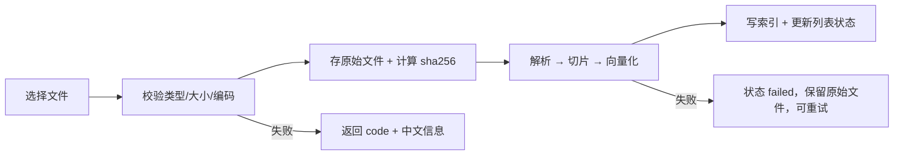

# 提示词 5：管理后台设计（服务端渲染）

对象：审核与质量负责人（业务侧）与数字化工程师（系统侧）。风格类 SaaS，服务端渲染，不引入前端框架。
后台**不提供**任何对外发送、写回源系统、自动通过的能力。

---

## 1. 角色与权限矩阵

| 能力 | `agent` | `reviewer` | `admin` |
| --- | --- | --- | --- |
| 聊天与自己的会话 | ✅ | ✅ | ✅ |
| 查看他人会话 | ❌ | ✅（只读） | ✅（只读） |
| 标记疑似越权承诺 | ❌ | ✅ | ❌ |
| 知识库上传/删除/重建索引 | ❌ | ❌ | ✅ |
| 提示词模板编辑/发布/回滚 | ❌ | 提议（提交草稿） | ✅ 发布 |
| 暂停/恢复试点 | ❌ | ✅ | ❌ |
| 审计链校验与导出 | ❌ | ✅ | ✅ |
| 系统配置（批次白名单、模型） | ❌ | ❌ | ✅ |

**职责分离**：能改提示词的人（admin）不能暂停试点，能暂停的人（reviewer）不能改提示词。两边同时越权才可能绕过边界，成本足够高。

---

## 2. 页面清单（7 个）

| # | 页面 | 路径 | 关键内容 |
| --- | --- | --- | --- |
| 1 | 登录 | `/admin/login` | 工号 + 密码；失败计数与锁定；登录后按角色跳转 |
| 2 | 概览 | `/admin` | 今日问答数、拒答率、待复核、暂停状态、最近审计告警 |
| 3 | 知识库 | `/admin/kb` | 文档列表（版本/有效期/确认人/状态）、上传、切片预览、重建索引、删除 |
| 4 | 提示词模板 | `/admin/prompts` | 当前生效模板、版本历史、编辑、发布、回滚、差异对比 |
| 5 | 对话审计 | `/admin/conversations` | 按员工/时间/风险筛选；详情；标记；导出 CSV |
| 6 | 系统设置 | `/admin/settings` | 批次白名单、模型与超时（只读展示）、暂停开关、保留期 |
| 7 | 审计链 | `/admin/audit` | 哈希链校验、按工单/人/动作查询、导出凭证 |

### 2.1 登录页

- 字段：工号、密码、验证码（5 次失败后出现）。
- 失败 5 次锁定 15 分钟，写 `login_failed` 审计。
- 成功后发 `access_token`（30 分钟，HttpOnly + SameSite=Lax Cookie）与 `refresh_token`（8 小时，仅 `/admin/auth/refresh` 可用）。

### 2.2 概览

四张卡 + 一条告警带：

| 卡 | 指标 | 口径 |
| --- | --- | --- |
| 今日问答 | 成功/拒答/阻塞 | 按 `messages.status` |
| 拒答率 | 拒答 ÷ 总回答 | 分原因码 Top 3 |
| 待复核 | 人工队列条数 | 按责任人分组 |
| 边界命中 | 收费/资格类问题数 | 只统计，不展示结论 |

告警带：审计链断点、快照降级、暂停中、7 天未处理队列。

### 2.3 知识库页

列表列：文档名、类型、所属批次、版本号、有效期、确认人、切片数、索引状态、更新时间、操作。

```text
[上传]  支持 .md / .txt（首版）；.pdf 需可选依赖 pypdf，缺失时提示 E_UNSUPPORTED_FORMAT
```

上传流程（同步 3 步 + 异步 1 步）：



- 切片参数：500 字、重叠 80、按 Markdown 标题分节（复用 `src/rag_qa.py`）。
- **删除 = 软删**：置 `deleted_at`，索引移除，但版本记录、审计与原始文件保留（f43：版本链不能断）。
- 同一 `notice_id + version_id` 重复上传 → `E_CONFLICT`，提示先作废再传。
- 切片预览：抽屉展示前 20 片，含字符区间，便于确认没切坏。

### 2.4 提示词模板页

- 当前生效模板高亮显示，含 `version`、`published_by`、`published_at`、`hash`。
- 编辑：CodeMirror 不引入，用等宽 `textarea` + 行号；支持变量白名单。
- 变量（只允许这些，多一个就拒绝发布）：`{{watermark}}`、`{{batch}}`、`{{citations}}`、`{{boundary_rules}}`、`{{refusal_template}}`。
- 发布 = 新增版本 + 置 `published=1` + 旧版置 0 + 清缓存；**立即生效**（下次请求读新模板）。
- 回滚 = 把历史版本重新发布为新版本（不删除历史）。
- 差异对比：并排显示新旧文本，按行 diff。
- 发布前校验：长度 ≤ 8000 字；必须包含"无引用不回答""不得对收费/资格承诺"两条硬约束；否则 `E_VALIDATION`。

### 2.5 对话审计页

筛选：员工工号、时间范围、状态（ok/refused/blocked）、原因码、是否标记、工单号。

列表列：时间、员工、工单、问题摘要、状态、引用版本、标记、操作。

详情抽屉：

1. 问题与回答全文；
2. 本轮引用（版本/条款/有效期/确认人）；
3. 实际送模型的历史（`context_snapshots`）；
4. 工具调用链（Agent 阶段）；
5. 标记区：`疑似越权承诺`、`引用过期版本`、`无引用回答`、`其他`，必填备注；
6. 只读提示："审计记录不可编辑，仅可追加标记"。

导出 CSV：按当前筛选，字段固定，附 `request_id` 便于回溯。

### 2.6 系统设置

- 批次白名单：只能加 `2026-S1` 这类已审批批次；改成空 → 拒绝（防空放行）。
- 模型：显示 provider/model/timeout，只读；改配置走配置文件与重启（避免后台改模型绕过评审）。
- 暂停开关：reviewer 可用，二次确认 + 必填原因，写审计。
- 保留期：会话 90 天、审计 365 天（建议值，待确认）。

### 2.7 审计链页

- 显示总条数、最后一条 hash、校验结果；
- 断点定位到 `seq`，并显示前后两条；
- 按工单/人/动作查询（精确匹配 `subject`，不做全文子串）；
- 导出凭证：JSONL + 校验说明，文件名带时间戳。

---

## 3. 接口清单

统一前缀 `/api/v1/admin`；除登录/刷新外都要求 `Authorization` 或 Cookie。

### 3.1 认证

| 方法 | 路径 | 权限 | 说明 |
| --- | --- | --- | --- |
| POST | `/auth/login` | 公开 | `{employee_id, password}` → token + 角色 |
| POST | `/auth/refresh` | 持 refresh | 换新 access |
| POST | `/auth/logout` | 登录态 | 失效 refresh |
| GET | `/auth/me` | 登录态 | 工号、角色、批次 |

### 3.2 知识库

| 方法 | 路径 | 权限 | 说明 |
| --- | --- | --- | --- |
| GET | `/kb/documents` | admin/reviewer | 分页、按批次/状态筛选 |
| POST | `/kb/documents` | admin | multipart：file + batch + notice_id + version_id + effective_from/to + confirmed_by |
| GET | `/kb/documents/{id}` | admin/reviewer | 元数据 + 切片数 + 索引状态 |
| GET | `/kb/documents/{id}/chunks` | admin/reviewer | 分页切片预览 |
| DELETE | `/kb/documents/{id}` | admin | 软删（保留版本链），需 `reason` |
| POST | `/kb/documents/{id}/reindex` | admin | 重建切片与向量 |
| GET | `/kb/search?q=` | admin/reviewer | 调试检索：返回 top5 与分数 |

### 3.3 提示词模板

| 方法 | 路径 | 权限 | 说明 |
| --- | --- | --- | --- |
| GET | `/prompts` | admin/reviewer | 当前生效 + 历史列表 |
| GET | `/prompts/{version}` | admin/reviewer | 单版内容 |
| POST | `/prompts` | admin | 新建草稿（不生效） |
| PUT | `/prompts/{version}` | admin | 改草稿（已发布不可改） |
| POST | `/prompts/{version}/publish` | admin | 发布，立即生效 |
| POST | `/prompts/{version}/rollback` | admin | 以历史版本新建发布 |
| GET | `/prompts/diff?from=&to=` | admin/reviewer | 行级差异 |
| POST | `/prompts/preview` | admin | 用样例输入渲染模板，不调用模型 |

### 3.4 对话审计

| 方法 | 路径 | 权限 | 说明 |
| --- | --- | --- | --- |
| GET | `/conversations` | reviewer/admin | 筛选 + 分页 |
| GET | `/conversations/{id}` | reviewer/admin | 消息、引用、历史快照 |
| POST | `/conversations/{id}/flags` | reviewer | `{kind, note}`；kind ∈ 四类 |
| DELETE | `/conversations/{id}/flags/{flag_id}` | reviewer | 撤销标记（追加审计，不物理删） |
| GET | `/conversations/export.csv` | reviewer | 当前筛选导出 |

### 3.5 系统与审计链

| 方法 | 路径 | 权限 | 说明 |
| --- | --- | --- | --- |
| GET | `/settings` | admin | 批次白名单、模型（脱敏）、保留期 |
| PUT | `/settings/batches` | admin | 改白名单，空值拒绝 |
| POST | `/pilot/pause` | reviewer | `{reason}`，二次确认 |
| POST | `/pilot/resume` | reviewer | 记录恢复人 |
| GET | `/audit/verify` | reviewer/admin | 返回 ok/断点 |
| GET | `/audit/events` | reviewer/admin | 按 subject/action/时间 |
| GET | `/audit/export` | reviewer/admin | JSONL 下载 |

### 3.6 错误响应

沿用 `chat-api.md` 第 7 节的错误码；后台额外两条：

| HTTP | code | 中文信息 |
| --- | --- | --- |
| 409 | `E_VERSION_CONFLICT` | 该版本号已存在，请先作废再上传 |
| 415 | `E_UNSUPPORTED_FORMAT` | 暂不支持该文件格式，请上传 Markdown 或纯文本 |

---

## 4. 数据模型（在聊天库基础上新增）

```sql
CREATE TABLE kb_documents (
  id            TEXT PRIMARY KEY,
  title         TEXT NOT NULL,
  path          TEXT NOT NULL,
  sha256        TEXT NOT NULL,
  batch         TEXT NOT NULL,
  notice_id     TEXT,
  version_id    TEXT NOT NULL,
  effective_from TEXT NOT NULL,
  effective_to   TEXT,
  confirmed_by   TEXT,
  doc_type      TEXT NOT NULL CHECK (doc_type IN ('md','txt','pdf')),
  status        TEXT NOT NULL CHECK (status IN ('uploaded','indexing','ready','failed','deleted')),
  chunk_count   INTEGER NOT NULL DEFAULT 0,
  error         TEXT,
  created_by    TEXT NOT NULL,
  created_at    TEXT NOT NULL,
  updated_at    TEXT NOT NULL,
  deleted_at    TEXT,
  delete_reason TEXT,
  UNIQUE (notice_id, version_id)
);

CREATE TABLE prompt_templates (
  id          TEXT PRIMARY KEY,
  version     INTEGER NOT NULL UNIQUE,
  content     TEXT NOT NULL,
  published   INTEGER NOT NULL DEFAULT 0,
  created_by  TEXT NOT NULL,
  created_at  TEXT NOT NULL,
  published_by TEXT,
  published_at TEXT,
  note        TEXT
);

CREATE TABLE flags (
  id          TEXT PRIMARY KEY,
  message_id  TEXT NOT NULL REFERENCES messages(id),
  kind        TEXT NOT NULL CHECK (kind IN ('boundary','stale_version','no_citation','other')),
  note        TEXT NOT NULL,
  created_by  TEXT NOT NULL,
  created_at  TEXT NOT NULL,
  revoked_at  TEXT
);
```

约束：同一时刻只能有一条 `published=1` 的模板（部分唯一索引 + 事务内切换）。

---

## 5. 鉴权实现（零依赖约束）

- 算法 HS256：`base64url(header).base64url(payload).hmac_sha256(secret)`，只用 `hmac`/`hashlib`/`json`。
- 密钥来自环境变量 `EXPO_JWT_SECRET`，长度 < 32 字节拒绝启动；支持双密钥轮换（`EXPO_JWT_SECRET_OLD`）。
- 密码：`hashlib.scrypt`（N=2^14, r=8, p=1）+ 16 字节随机盐，存 `scrypt$N$r$p$salt$hash`。
- 校验：签名 → exp → `role` → `batch` 白名单 → 资源归属（会话只能看自己，reviewer 例外）。
- 不引入 PyJWT/python-jose；在 `SECURITY.md` 标注"自实现 JWT 仅用于单机试点，上生产前需安全评审"。

---

## 6. 服务端渲染与安全

| 风险 | 处理 |
| --- | --- |
| XSS | Jinja2 自动转义；聊天内容用 `textContent` 插入，禁用 `innerHTML` |
| CSRF | 表单带一次性 token；Cookie `SameSite=Lax`；写操作只接受 POST |
| 路径穿越 | 文件名只作展示，落盘名用 `sha256` + 扩展名白名单 |
| 上传炸弹 | 单文件 ≤ 5 MB，切片前检查总字数 ≤ 200 万 |
| 越权 | 每个路由显式 `@require_role(...)`，不靠前端隐藏 |
| 密钥泄露 | 模板渲染上下文不含环境变量；错误页不显示堆栈 |

---

## 7. 验收清单

| # | 场景 | 期望 |
| --- | --- | --- |
| 1 | agent 访问 `/admin/kb` | 403 + 中文提示 |
| 2 | reviewer 发布模板 | 403（只能提交草稿） |
| 3 | admin 发布含缺失硬约束的模板 | 422，指出缺少哪条 |
| 4 | 发布后下一次问答 | 使用新模板（prompt_hash 变化） |
| 5 | 上传 6 MB 文件 | 413，中文提示 |
| 6 | 上传重复版本 | 409 `E_VERSION_CONFLICT` |
| 7 | 删除文档 | 列表消失，审计与版本记录仍在 |
| 8 | 暂停后聊天 | 423 `E_PILOT_PAUSED` |
| 9 | 审计标记 | 只追加，不可改；导出含标记 |
| 10 | 审计链被改一行 | `verify` 定位到 seq |

---

## 8. 未决问题

1. 模板"提议—发布"两段式是否必要？当前按职责分离设计，reviewer 只能提议。
2. PDF 解析是否纳入首版？建议不纳入，先 Markdown，PDF 走人工转换并留痕。
3. 后台是否要展示成本（token 费用）？建议只给 admin 看汇总，不细化到人。
