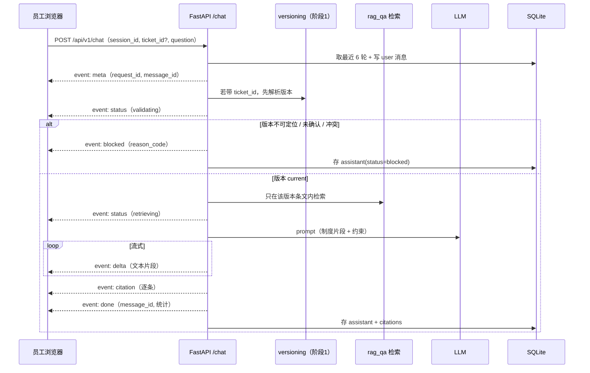
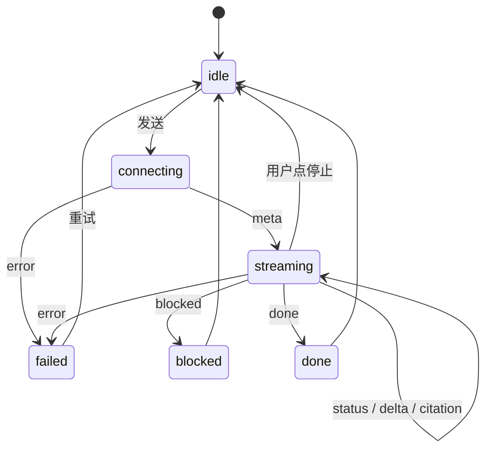

# 提示词 4：员工问答入口（SSE 设计）

对象：一线服务专员与项目流程协调员。目的不是"替展商回答"，而是**帮内部人员把答复依据固定下来**：
先定版本，再取条文，再给带引用的草稿素材；定不下来就拒答并转人工。

---

## 1. 目标与非目标

| 目标 | 非目标 |
| --- | --- |
| 单页聊天，逐字返回，状态可见 | 不做多轮任务编排（那是 Agent 阶段，见 `agent-tools.md`） |
| 每轮回答必须带版本与条款引用 | 不生成对外发送动作 |
| 会话与消息落 SQLite，可审计 | 不把聊天记录当事实依据 |
| 6 轮上下文，支持追问 | 不做跨会话记忆 |
| 版本不确定时明确拒答 | 不对收费/资格给结论 |

---

## 2. 角色与鉴权

| 角色 | 可用接口 | 说明 |
| --- | --- | --- |
| `agent`（一线/流程协调） | chat、会话读取、反馈 | 只能看自己的会话 |
| `reviewer`（审核与质量负责人） | 上述 + 审计只读 | 可看他人会话，不可改 |
| `admin`（数字化工程师） | 上述 + 知识库/模板 | 不参与业务结论 |

JWT 放 `Authorization: Bearer`，claims 至少含 `sub`（工号）、`role`、`batch`（授权批次）、`exp`。
`batch` 不在 `pilot.batch` 白名单 → `E_FORBIDDEN`。

---

## 3. 一次问答的时序



---

## 4. 接口清单

| 方法 | 路径 | 作用 | 成功 | 主要错误 |
| --- | --- | --- | --- | --- |
| POST | `/api/v1/chat` | 提问，SSE 流式回答 | 200 `text/event-stream` | 401/403/404/409/422/423/429/502/504 |
| GET | `/api/v1/sessions` | 我的会话列表（分页） | 200 | 401 |
| GET | `/api/v1/sessions/{id}/messages` | 历史消息 + 引用 | 200 | 403/404 |
| DELETE | `/api/v1/sessions/{id}` | 软删自己的会话 | 204 | 403/404 |
| POST | `/api/v1/messages/{id}/feedback` | 标"有用/无用/有误" | 201 | 404/409 |
| GET | `/api/v1/tickets/{ticket_id}/context` | 工单双时间、字段状态、当前版本 | 200 | 404 |
| GET | `/api/v1/health` | 存活与依赖状态（不含密钥） | 200 | — |

约定：

- 所有路径前缀 `/api/v1`，请求带 `X-Request-Id`（可选，服务端回填）。
- 时间统一 ISO 8601 +08:00。
- 非 SSE 接口一律 `{ "data": ..., "request_id": "..." }`；错误一律 `{ "error": {...} }`。

---

## 5. `POST /chat` 契约

### 5.1 请求

```json
{
  "session_id": "S-7f3c1a",
  "ticket_id": "T-1001",
  "question": "这家展商问搭建高度限制，我该引用哪一版说明？",
  "client_turn_id": "c-01",
  "stream": true
}
```

| 字段 | 必填 | 规则 |
| --- | --- | --- |
| `session_id` | 否 | 空则新建，`meta` 事件返回 |
| `ticket_id` | 否 | 带上则先解析版本；不带则只做政策问答，禁止讨论具体展商结论 |
| `question` | 是 | 1–2000 字；空白/超长 → `E_VALIDATION` |
| `client_turn_id` | 否 | 会话内唯一，重试幂等；重复返回原消息 |
| `stream` | 否 | 默认 `true`；`false` 时返回一次性 JSON（给测试用） |

`ticket_id` 还必须是当前 JWT 的 `batch` 白名单内，否则 `E_FORBIDDEN`（跨批次即越权，对应 f32）。

### 5.2 SSE 事件

`Content-Type: text/event-stream; charset=utf-8`，每 15 秒 `: ping` 心跳；`retry: 3000`。

| event | data | 说明 |
| --- | --- | --- |
| `meta` | `{request_id, session_id, message_id, created_at}` | 第一个事件，前端据此落 UI |
| `status` | `{stage, text}` | `stage`: `accepted` / `validating` / `retrieving` / `generating`；`text` 为界面文案 |
| `delta` | `{text}` | 文本片段，前端追加（打字机） |
| `citation` | 见 5.4 | 一条引用，可多次 |
| `blocked` | `{reason_code, message, queue_owner, actions[]}` | 拒答/转人工，不再有 delta |
| `done` | `{message_id, turns_used, tokens_in, tokens_out, latency_ms, finish_reason}` | 正常结束 |
| `error` | `{code, message, retryable}` | 流中异常，发完即关闭，不发 `done` |

`finish_reason`: `stop` / `length` / `blocked` / `aborted`。

### 5.3 一次成功流（示例）

```text
event: meta
data: {"request_id":"r-9a1","session_id":"S-7f3c1a","message_id":"M-02","created_at":"2026-10-30T10:22:00+08:00"}

event: status
data: {"stage":"validating","text":"正在核对版本与字段…"}

event: status
data: {"stage":"retrieving","text":"正在检索制度…"}

event: delta
data: {"text":"依据 "}
event: delta
data: {"text":"《展位搭建说明》V-1002（2026-07-01 至 2026-12-31，唐映秋确认）"}

event: citation
data: {"citation_id":"C-1","doc":"file_index.csv","path":"rules/booth-2026S1.md","heading":"三、搭建高度","version_id":"V-1002","notice_id":"N-2026-0702","effective_from":"2026-07-01","effective_to":"2026-12-31","confirmed_by":"唐映秋","snippet":"标准展位搭建高度不得超过 4 米……","score":0.83}

event: done
data: {"message_id":"M-02","turns_used":2,"tokens_in":1830,"tokens_out":240,"latency_ms":4200,"finish_reason":"stop"}
```

### 5.4 引用对象

```json
{
  "citation_id": "C-1",
  "doc": "file_index.csv",
  "path": "rules/booth-2026S1.md",
  "heading": "三、搭建高度",
  "version_id": "V-1002",
  "notice_id": "N-2026-0702",
  "effective_from": "2026-07-01",
  "effective_to": "2026-12-31",
  "confirmed_by": "唐映秋",
  "snippet": "标准展位搭建高度不得超过 4 米……",
  "score": 0.83
}
```

**引用必须能回到版本**。只有文件名、没有 `version_id` 的引用一律视为不合格（阶段 1 的老问题就是这么来的）。
前端引用卡展示"文件 + 章节 + 版本 + 有效期 + 确认人"，点击展开原文。

---

## 6. 回答类型与拒答

| 类型 | HTTP/事件 | 触发条件 | 前端表现 |
| --- | --- | --- | --- |
| `ok` | 流 + `done.stop` | 版本 current、检索命中、无越权 | 正常显示 + 引用卡 |
| `refused` | `blocked` + `reason_code` | 无命中、版本过期/未确认/冲突、字段缺失 | 黄色提示 + "转人工"按钮 |
| `blocked` | `blocked` + `E_BOUNDARY_BLOCKED` | 收费/报价/折扣/退款/参展资格/押金 | 红色边界卡 + 授权人名单 |
| `error` | `error` | LLM 超时、上游 5xx | 红色错误 + 重试 |

`reason_code` 取值：`NO_EVIDENCE`、`VERSION_EXPIRED`、`VERSION_UNCONFIRMED`、`VERSION_CONFLICT`、`FIELDS_MISSING`、`AUTHORIZATION_UNCLEAR`、`PILOT_PAUSED`、`BOUNDARY_FEE_OR_QUALIFICATION`。

拒答文案示例（固定，不交给模型自由发挥）：

> 无法确认当前有效版本（原因：替代链断裂）。已列为人工复核，责任人：数字化工程师，时限 24 小时。

---

## 7. 错误码

| HTTP | code | 中文信息 | 何时 |
| --- | --- | --- | --- |
| 401 | `E_AUTH_REQUIRED` | 请先登录 | 无/坏 token |
| 401 | `E_TOKEN_EXPIRED` | 登录已过期，请重新登录 | exp 过期 |
| 403 | `E_FORBIDDEN` | 没有权限执行该操作 | 角色/batch 不符 |
| 403 | `E_BOUNDARY_BLOCKED` | 该问题涉及收费或参展资格，需授权人确认 | 越权承诺 |
| 404 | `E_SESSION_NOT_FOUND` | 会话不存在或已删除 | 会话 ID 无效 |
| 404 | `E_TICKET_NOT_FOUND` | 工单不存在或不在授权批次内 | 工单 ID 无效 |
| 409 | `E_PRECONDITION` | 当前状态不允许该操作 | 工单未解析版本等 |
| 422 | `E_VALIDATION` | 请求参数不合法：{字段} | 校验失败 |
| 423 | `E_PILOT_PAUSED` | 试点已暂停，暂停期间不生成回答 | 审核方暂停 |
| 429 | `E_RATE_LIMITED` | 请求过于频繁，请 {n} 秒后重试 | 10 次/分/人 |
| 500 | `E_INTERNAL` | 服务内部错误，已记录 request_id | 未捕获异常 |
| 502 | `E_UPSTREAM_LLM` | 模型服务返回错误，请稍后重试 | LLM 5xx |
| 504 | `E_UPSTREAM_TIMEOUT` | 模型响应超时，已中止本次回答 | 首 token > 8s 或总 > 45s |

规则：所有错误先给 `code` 再给中文 `message`；`request_id` 必带；不得把上游原文、堆栈、密钥返回前端。

---

## 8. SQLite 数据模型

阶段 1 用运行目录（JSONL + 快照）保存证据；聊天侧新增 SQLite 存会话，两者用 `ticket_id` 关联，**不复制判定结果**（避免两套真相）。

```sql
PRAGMA journal_mode = WAL;
PRAGMA foreign_keys = ON;

CREATE TABLE sessions (
  id          TEXT PRIMARY KEY,
  actor_id    TEXT NOT NULL,
  role        TEXT NOT NULL,
  batch       TEXT NOT NULL,
  ticket_id   TEXT,
  title       TEXT,
  created_at  TEXT NOT NULL,
  updated_at  TEXT NOT NULL,
  deleted_at  TEXT
);

CREATE TABLE messages (
  id            TEXT PRIMARY KEY,
  session_id    TEXT NOT NULL REFERENCES sessions(id),
  turn_index    INTEGER NOT NULL,
  role          TEXT NOT NULL CHECK (role IN ('user','assistant')),
  content       TEXT NOT NULL,
  status        TEXT NOT NULL CHECK (status IN ('ok','refused','blocked','error','aborted')),
  reason_code   TEXT,
  model         TEXT,
  prompt_hash   TEXT,
  tokens_in     INTEGER,
  tokens_out    INTEGER,
  latency_ms    INTEGER,
  client_turn_id TEXT,
  created_at    TEXT NOT NULL,
  UNIQUE (session_id, client_turn_id)
);

CREATE TABLE citations (
  id          TEXT PRIMARY KEY,
  message_id  TEXT NOT NULL REFERENCES messages(id) ON DELETE CASCADE,
  ord         INTEGER NOT NULL,
  doc         TEXT NOT NULL,
  path        TEXT,
  heading     TEXT,
  version_id  TEXT NOT NULL,      -- 没有版本号的引用不允许入库
  notice_id   TEXT,
  effective_from TEXT,
  effective_to   TEXT,
  confirmed_by   TEXT,
  snippet     TEXT NOT NULL,
  score       REAL
);

CREATE TABLE context_snapshots (
  message_id  TEXT PRIMARY KEY REFERENCES messages(id) ON DELETE CASCADE,
  turns_used  INTEGER NOT NULL,
  chars_used  INTEGER NOT NULL,
  history_json TEXT NOT NULL      -- 实际送进模型的历史，审计用
);

CREATE TABLE feedback (
  id         TEXT PRIMARY KEY,
  message_id TEXT NOT NULL REFERENCES messages(id),
  actor_id   TEXT NOT NULL,
  kind       TEXT NOT NULL CHECK (kind IN ('useful','useless','wrong')),
  note       TEXT,
  created_at TEXT NOT NULL
);

CREATE TABLE audit_events (
  seq        INTEGER PRIMARY KEY AUTOINCREMENT,
  at         TEXT NOT NULL,
  actor_id   TEXT NOT NULL,
  action     TEXT NOT NULL,
  subject    TEXT NOT NULL,
  details    TEXT NOT NULL,
  prev_hash  TEXT NOT NULL,
  hash       TEXT NOT NULL
);

CREATE INDEX idx_messages_session ON messages(session_id, turn_index);
CREATE INDEX idx_citations_message ON citations(message_id);
CREATE INDEX idx_sessions_actor ON sessions(actor_id, updated_at);
CREATE INDEX idx_audit_subject ON audit_events(subject, seq);
```

`audit_events` 的 `prev_hash/hash` 与阶段 1 同构：`sha256(prev_hash + canonical_json(不含 hash))`。

---

## 9. 最近 6 轮上下文规则

1. 一"轮" = 一条 user + 一条 assistant（`status in ('ok','refused','blocked')`）。
2. 取当前问题之前**最近 6 轮**，按时间正序送入；不含当前问题本身。
3. 总字符上限 6000：超了从最老的轮次开始丢，至少保留 1 轮；丢了几轮要写进 `context_snapshots`。
4. 历史里的引用**不重新生效**：本轮必须重新检索、重新给引用；历史只用于理解"它/那家/上一版"指代。
5. 历史里出现过的版本号，若本轮判定已过期，明确提示"上一轮引用的 V-1005 已过期"。
6. `error` 与 `aborted` 消息不进历史。

---

## 10. 前端设计（单页，HTML + 原生 JS）

### 10.1 布局

```text
┌────────────────────────────────────────────────┐
│ 展商咨询工单助手        [工单选择] [批次徽标]  │
│ 草稿素材 · 不可对外（固定水印条）              │
├────────────────────────────────────────────────┤
│ 消息区（用户右 / 助手左）                       │
│  ├ 助手气泡：正文 + 引用卡（可折叠）            │
│  └ 拒答：黄色/红色卡片 + 转人工按钮             │
├────────────────────────────────────────────────┤
│ [输入框……………………………]  [发送]  [停止]        │
│ 状态行：正在检索制度… · 已用 2/6 轮             │
└────────────────────────────────────────────────┘
```

### 10.2 前端状态机



### 10.3 交互细节

- **打字机**：收到 `delta` 追加文本；渲染用 `requestAnimationFrame` 批量刷新，避免每字符 reflow。
- **状态文案**：`validating` → "正在核对版本与字段…"；`retrieving` → "正在检索制度…"；`generating` → "正在生成…"。
- **引用卡**：默认显示 `文件 · 章节`，展开显示版本、有效期、确认人、原文片段；`version_id` 缺失则不渲染（视为异常）。
- **停止**：abort 连接，本地标记"已停止"，服务端存 `status=aborted`，不写引用。
- **断线重连**：`EventSource` 不支持自定义 header，改用 `fetch` + `ReadableStream` 手写解析；断线后允许"重试本轮"，用 `client_turn_id` 幂等。
- **水印**：页面顶部固定"未确认 · 不可对外"，截图也带着。
- **复制**：只提供"复制草稿素材"，不提供"发送"。

### 10.4 无障碍与降级

- `aria-live="polite"` 播报状态；`prefers-reduced-motion` 时关闭打字机。
- `stream=false` 时一次性渲染（老浏览器/测试）。

---

## 11. 验收清单

| # | 场景 | 期望 |
| --- | --- | --- |
| 1 | 正常提问（T-1001） | 逐字返回；≥1 条引用含 `version_id` |
| 2 | 引用过期版本 | `blocked/VERSION_EXPIRED`，不给结论 |
| 3 | 无命中 | `blocked/NO_EVIDENCE`，不调用模型 |
| 4 | 收费问题 | `blocked/E_BOUNDARY_BLOCKED`，列授权人 |
| 5 | 试点暂停 | 423 `E_PILOT_PAUSED`，不生成 |
| 6 | 跨批次工单 | 403 `E_FORBIDDEN` |
| 7 | 同 `client_turn_id` 重试 | 返回同一条消息，不重复计费 |
| 8 | 第 7 轮 | 只带最近 6 轮，`context_snapshots` 可查 |
| 9 | 断开连接 | `aborted`，无引用落库 |
| 10 | 审计 | `chat_asked` / `chat_answered` / `citation_attached` 可查 |

---

## 12. 未决问题

1. 员工能否在聊天里直接修改工单字段？本设计：**不能**（只读），修改走阶段 1 的导出与重跑。
2. 会话保留多久？建议 90 天，与阶段 1 审计留存一致，待你确认。
3. 是否允许 reviewer 在聊天页直接"确认"某条回答？本设计：**不允许**，确认只能在复核流程里做，避免两套确认入口。
