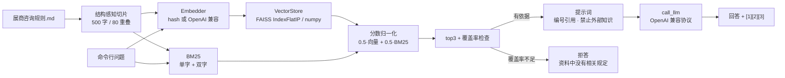

# 展商咨询规则裸问答原型（阶段 1）

单文件 Python 脚本，无 Web、无框架：**读 Markdown 规则 → 500 字切片 → 向量化 → BM25 + 向量混合检索 top3 → 拼提示词 → 调 LLM → 带引用的回答**。

这是[《v2 架构选型方案》](architecture-v2/01-架构选型方案.docx)里「智能体编排层 + 检索」的最小可运行版本，用来在接 FastAPI、接数据库之前，先把**检索质量和提示词边界**验证掉。

## 一、先回答"有没有生成"

在本目录出现之前，仓库里只有 v2 的**设计方案**，没有任何 RAG 实现：全仓检索 `faiss`、`rank_bm25`、`embedding` 均无命中，也没有读规则文件、切片、调 LLM 的脚本。所以这一项是**缺失**的，现在补齐。

| 提示词要求 | 实现位置 |
| --- | --- |
| 读本地规则 Markdown | `load` 阶段，`--policy` 可换任意 `.md` |
| 500 字切片 + 向量化 + FAISS | `chunk_text()` / `Embedder` / `VectorStore`；有 faiss 用 `IndexFlatIP`，没有则 numpy 精确检索 |
| 命令行输入 → BM25 + 向量 top3 | `main()` → `hybrid_search()`，`--top-k` 默认 3 |
| 拼提示词 → 调 LLM | `build_messages()` → `call_llm()` |
| LLM 封装独立、供应商可配置 | `call_llm()` 单出口；`--provider openai/deepseek/ollama/mock` |
| 详细中文注释 + 标注复用模块 | 全文分 12 段注释；函数带 `[核心·阶段2复用]` / `[原型专用]` |

## 二、快速开始

```bash
# 只需要 numpy；faiss 可选
python -m pip install numpy

# 1) 离线自检（29 项，不联网）
python src/rag_qa.py --selftest

# 2) 问一个问题（默认 mock，不调用真实模型，只看链路）
python src/rag_qa.py -q "展商住宿代订标准是多少？"

# 3) 接真实模型（任选其一）
export DEEPSEEK_API_KEY=sk-...
python src/rag_qa.py -q "发票丢了还能补开吗？" --provider deepseek

export OPENAI_API_KEY=sk-...
python src/rag_qa.py -q "住宿超出代订标准怎么办？" --provider openai --model gpt-4o-mini

# 本地 Ollama（无需 key）
python src/rag_qa.py -q "收费类问题应该转给谁" --provider ollama --model qwen2.5:7b
```

真实输出（mock 模式，语料为 `data/policy/展商咨询规则.md`）：

```text
[索引] .rag-index｜切片 11｜后端 numpy｜新建

问题：展商住宿代订标准是多少？

检索（BM25 + 向量，top3）：
  [1] 融合 1.000（BM25 27.278 / 向量 0.358）  五、住宿与差旅代订标准
  [2] 融合 0.379（BM25 13.134 / 向量 0.099）  一、总则
  [3] 融合 0.300（BM25 7.212 / 向量 0.120）  九、完成口径与统计

回答：
（离线 mock 模式：未调用真实模型，以下为资料原文摘录）
第十四条 试点批次为展商提供住宿代订服务，按场馆所在城市分档，凭住宿发票在标准内据实结算……
| 一线城市 | 上海、北京、广州、深圳 | 650 | [1]
依据：五、住宿与差旅代订标准
```

没有依据时不会硬答：

```text
问题：公司年会在哪里举办？
回答：资料中没有相关规定。请补充问题背景，或联系项目流程协调员确认。
```

## 三、链路



## 四、几个关键设计

**1. 切片按标题分节，而不是全文硬切。**
规则的语义边界是"条"和"节"。对全文做 500 字滑窗，会把"二、咨询受理与分类"的结尾和"五、住宿与差旅代订标准"的开头塞进同一片——实测这一片会同时命中"受理""住宿""标准"，把真正讲住宿的那一片压到第二名。现在每个标题单独开节，节内滑窗、切片不跨节，引用也能显示"五、住宿与差旅代订标准"。

**2. BM25 不引词典，中文用单字 + 相邻双字。**
`住宿标准` → `住/宿/标/准` + `住宿/宿标/标准`。对规则术语足够稳，且不需要 jieba，离线可跑。公式是标准 Okapi：`idf = ln((N-df+0.5)/(df+0.5)+1)`，`k1=1.5`、`b=0.75`。

**3. 两路分数各做 min-max，再加权。**
BM25 无上界，余弦在 [-1,1]，直接相加会被量纲吞掉。归一化后 `score = alpha·向量 + (1-alpha)·BM25`，`--alpha` 默认 0.5。

**4. 拒答看"覆盖率"，不看融合分。**
min-max 之后排名第一的融合分总接近 1.0，单看分数永远像"很有把握"。所以另算一个指标：问题里的双字词有多少出现在 top1 片段里。低于 0.2 直接拒答，不调用模型。这是"宁可不答，也不编"在代码里的落点。

**5. 提示词只做四件事**：限定只能用资料、强制 `[编号]` 引用、无依据必须拒答、金额/比例/时限必须引原文数字。另外明确"不承诺展位、收费或参展资格结果"，把不可逆边界留给人工。没有"请你准确回答"这类无效指令。

## 五、LLM 供应商配置

`call_llm()` 是唯一出口，走 OpenAI 兼容的 `/chat/completions`：

| provider | base_url | 默认模型 | 需要的环境变量 |
| --- | --- | --- | --- |
| `openai` | `https://api.openai.com/v1` | `gpt-4o-mini` | `OPENAI_API_KEY` |
| `deepseek` | `https://api.deepseek.com/v1` | `deepseek-chat` | `DEEPSEEK_API_KEY` |
| `ollama` | `http://localhost:11434/v1` | `qwen2.5:7b` | 无 |
| `mock` | — | `extractive-mock` | 无（离线摘录） |

可覆盖：`LLM_BASE_URL`（任意兼容端点）、`LLM_MODEL`、`--model`、`--provider`。`mock` 只用于验证链路，输出会明确标注"未调用真实模型"，不要拿它当回答质量。

## 六、FAISS 与 numpy 两条路径

- 装了 `faiss-cpu`：`VectorStore.backend = "faiss"`，使用 `IndexFlatIP`（向量已 L2 归一化，内积即余弦），索引落盘为 `index.faiss`。
- 没装：自动退化为 numpy 矩阵乘法，`vectors.npy` 已足够，**top-k 与分数与 FAISS 完全一致**（本机两条路径都实测过）。
- 在装了 FAISS 的机器上建索引、换到没装的机器读：`load()` 发现后端不可用会自动用 `vectors.npy` 重建 numpy 路径，不报错、不重算 embedding。

## 七、哪些是阶段 2 会复用的

| 代码 | 复用位置 |
| --- | --- |
| `chunk_text()` | 规则/通知入库 worker |
| `Embedder` | 文档/查询向量化，换供应商只改这里 |
| `VectorStore` | 检索服务（FAISS 或 pgvector 的抽象层） |
| `BM25` + `hybrid_search()` | `/chat` 的召回逻辑 |
| `build_messages()` | 提示词模板，含引用编号 |
| `call_llm()` | 唯一模型出口，便于限流、计费、审计 |
| `query_coverage()` | 拒答/低置信度转人工的判据 |
| `answer_question()` | `/chat` 的内部实现（去掉打印即可） |

`[原型专用]` 的是：命令行参数、`_print_result()`、`ensure_index()`、`_selftest()`。

## 八、已知限制

1. `hash` embedding 只做字面相似，**没有语义能力**；生产必须换 `openai` 或自建向量模型，并重新建索引。
2. `mock` 只是原文摘录，不代表模型能力；回答质量要用真实供应商 + 评测集评估。
3. 没有 rerank、没有查询改写、没有多轮上下文；top3 里仍可能出现"相关但不回答"的片段。
4. 切片按字符计，表格行可能被截断；引用定位到"节"，还没细到"第几条"。
5. 单文件、单进程，没有并发、缓存与鉴权——这些属于阶段 2。
6. 本原型只做"检索 + 回答"，**不做版本判定**：判断"哪一版现行"是阶段 2 的闸门（见 [docs/phase2/](phase2/README.md) 第 4 节），不在这里用相似度猜。

## 九、下一步（阶段 2 之前）

- 建 20–30 条问题的评测集（含 5 条"规则没写"的拒答题），把召回率与拒答准确率量化；
- 换真实 embedding 后对比 hash 的召回差异；
- 引用从"节"细化到"条款号"，为前端高亮做准备；
- 接 v2 的规则版本表：切片表加 `version_id`，检索前先按"现行版本"过滤。

## 十、数据与许可

`data/policy/展商咨询规则.md` 为合成规则（2026 上海国际消费品博览会试点批次），单位、金额、编号与确认人均为虚构，不对应任何真实主体或真实展会。代码采用 MIT（与本仓库一致）。
