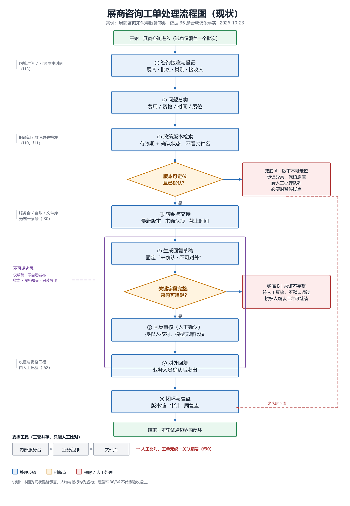
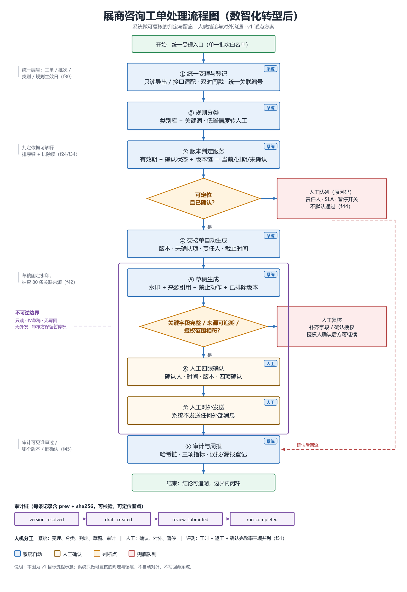
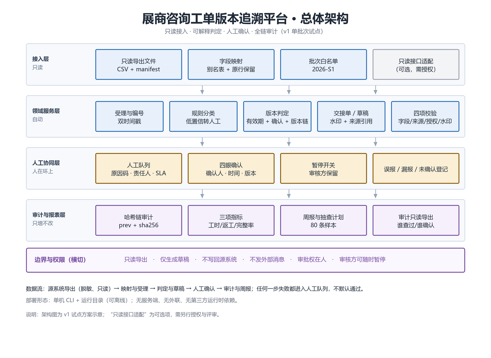

# v1 设计方案

展商咨询工单版本追溯试点（expo-ticket-trace）的**方案包**：业务挖掘、行业分析、两张流程图与总体架构、总体设计、报价单。

- 案例：展商咨询知识与服务转派（上海外经贸商务展览有限公司，案例设定）
- 范围：单批次（2026-S1）、只读接入、只生成草稿、人工确认、全链审计
- 数据性质：合成访谈与演示数据，人物、指标、金额均为虚构；**不是真实客户数据**
- 对应代码：[`../src/expo_trace`](../../src/expo_trace)、[`../docs`](..)、[`../README.md`](../../README.md)

---

## 一、交付清单

| # | 文件 | 内容 | 规模 |
|---|------|------|------|
| 01 | [`01-业务挖掘报告.docx`](01-业务挖掘报告.docx) | 62 条记录 → 36 条事实；六角色权责；八环节留痕断点；六条需求假设与验收；字段与四态；证据缺口 | 约 13 页 |
| 02 | [`02-行业分析.docx`](02-行业分析.docx) | 行业边界与口径、市场结构、数字化现状与成熟度、技术边界、政策合规、替代方案对比、对 v1 的启示 | 约 11 页 |
| 03 | [`03-流程图说明.docx`](03-流程图说明.docx) | 两张流程图 + 总体架构图的读图说明、差异对照、失败路径、Mermaid 源码 | 约 13 页 |
| 04 | [`04-报价单.xlsx`](04-报价单.xlsx) | 交付物与人天报价、税额与合计、付款方式、WBS 人天核算、前提与风险 | 3 个工作表 |
| 05 | [`05-设计方案.docx`](05-设计方案.docx) | 目标与非目标、需求基线、架构、数据与判定规则、安全、指标、实施、验收、风险、演进 | 约 18 页 |
| — | [`03-图表/`](03-图表) | 现状流程图、数智化转型后流程图、总体架构图（1700px 宽 PNG） | 3 张 |

> 文档中的页码为估算值，实际以 Word 排版为准；图片为脚本绘制的高分辨率 PNG。

---

## 二、三张图

### 现状流程

### 数智化转型后流程

### 总体架构

图元约定：蓝色矩形=处理步骤，黄色菱形=判断点，红色矩形=兜底/人工队列，紫色虚线框=不可逆边界，红色虚线=回流。编号 ①–⑧ 与业务挖掘报告一致。

---

## 三、阅读顺序

1. **业务挖掘报告**：先看“今天卡在哪里”——时间错位、版本漂移、编号缺失三类断点，以及六条需求假设。
2. **现状流程图**：把断点放回流程里看，注意两个判断点都没有“记录依据”的动作。
3. **数智化转型后流程图**：看系统做什么、人做什么，以及两个兜底为什么都指向人工队列。
4. **设计方案**：判定规则（有效期 + 确认状态 + 版本链）、数据字段、四项确认、审计链、三项指标。
5. **行业分析**：把单点方案放回行业背景，理解为什么“版本治理优先于模型能力”。
6. **报价单**：范围、人天、假设与不含项；金额为示例。

---

## 四、关键结论

- **版本不是文件**：判定只看有效期、确认状态、版本链，文件名与修改时间不参与。演示数据里“最新版_展位说明_最终版.pdf”过期且未确认，必须输给有效期覆盖的旧文件。
- **缺失 ≠ 未确认**：空值、写“未确认”、格式无效、有效是四种状态，处理方式不同；补默认值会掩盖问题。
- **失败进队列**：无法判定、来源不完整、授权不清一律进人工队列，带原因码、责任人与截止时间，不默认通过。
- **不可逆动作在系统外**：只出草稿，固定水印“未确认 · 不可对外”；发布、收费、资格决定由授权人完成；代码层没有外发接口。
- **完成口径三项并列**：处理工时、返工次数、确认完整率；单一效率指标会掩盖返工。
- **审计先于自动化**：谁查过、用哪一版、提了什么建议、谁确认，全部进哈希链；本地链无外部锚点，需定期导出留痕。

---

## 五、边界与合规

| 项目 | 约定 |
|------|------|
| 数据 | 仅使用脱敏只读导出；联系方式在进入运行目录前掩码 |
| 批次 | 仅 2026-S1；manifest 声明授权范围与用途，越界即拒绝运行 |
| 输出 | 仅草稿与内部报表；不写回源系统、不发外部消息 |
| 审批 | 四项确认由授权人完成；收费/资格仅限指定角色 |
| 暂停 | 审核方可随时暂停，系统停止生成草稿 |
| 留存 | 审计与确认记录建议保留 1 年；输入与草稿试点结束后 30 天内删除 |

行业数据仅引用一项可核验口径：中国贸促会《中国展览经济发展报告 2024》——2024 年境内经贸类展会 3,844 场、展览总面积 1.55 亿平方米、面积同比 +10.1%（转引自 [gov.cn 图解](https://www.gov.cn/zhengce/jiedu/tujie/202501/content_6997732.htm)）。其余为定性判断，未编造统计数字。

---

## 六、维护

- 文档编号：`v1-BD-001`（业务挖掘）、`v1-IA-001`（行业分析）、`v1-FC-001`（流程图）、`v1-DS-001`（设计方案）、`QT-2026-1023-01`（报价）。
- 修改规则：先改流程图/表格中的事实，再改正文结论；涉及范围、金额、验收口径的修改需在文末“修订记录”登记。
- 版本号：结构性调整升 minor（v1.1），文字修订升 patch（v1.0.1）。
- 图表重绘：优先改 Mermaid 源码或绘制脚本，不直接拉伸 PNG。

---

## 七、许可

文档与图片随仓库采用 MIT 许可（见 [`../LICENSE`](../../LICENSE)）；`data/` 与本文档中的案例数据为合成样本，不含真实企业或个人数据。
