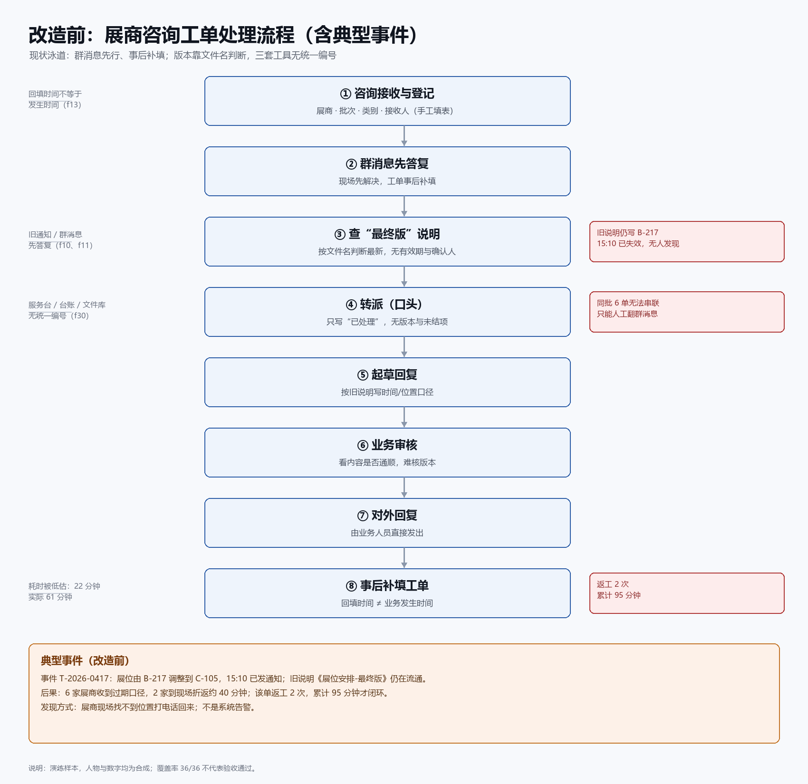
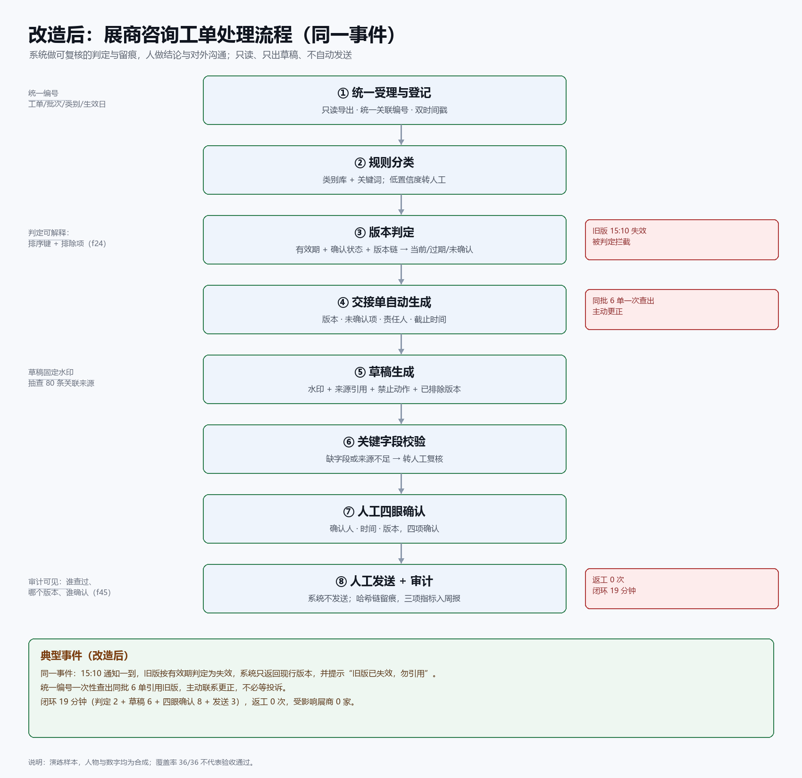

# 展商咨询知识与服务转派 · 项目说明文件

> 版本 v1.0 ｜ 报告生成 2026-10-23T01:45:19.403Z ｜ 文档构建 2026-11-06 ｜ 三形式同源（md / json / csv）
>
> 合成场景：人物、指标与业务问题均为虚构；企业名称与公开业务方向有公开来源。需求为待验证假设。

## 目录

- [第一部分 · 项目基本简报](#第一部分--项目基本简报)
  - [一、客户简报](#一客户简报)
  - [二、现状信息请求表](#二现状信息请求表)
  - [三、业务发现访谈问题库](#三业务发现访谈问题库)
  - [四、利益相关者资料与分工](#四利益相关者资料与分工)
  - [五、六项需求假设](#五六项需求假设)
  - [六、待核实问题](#六待核实问题)
  - [七、方法与局限](#七方法与局限)
- [第二部分 · 六人访谈记录](#第二部分--六人访谈记录)
- [第三部分 · 典型事件](#第三部分--典型事件)
- [第四部分 · 两张流程图](#第四部分--两张流程图)
- [附录 · 三种形式与使用说明](#附录--三种形式与使用说明)

---

# 第一部分 · 项目基本简报

## 一、客户简报

| 项目 | 内容 |
| --- | --- |
| 客户 | 上海外经贸商务展览有限公司 |
| 行业 | 展览组织 |
| 案例 | 展商咨询知识与服务转派 |
| 访谈覆盖 | 36/36（100%） |
| 公开来源 | [会展集团 · 核心企业](https://www.dlg-expo.com/Home/Enterprise) |

### 1.1 初始诉求

> 【演练假设】围绕展商咨询工单，团队希望减少重复核对并提高服务可追溯性。请访谈不同角色，核实问题与可行的试点范围。

### 1.2 试点边界（客户口述，待书面确认）

| 边界项 | 当前口径 |
| --- | --- |
| 覆盖范围 | 仅一个批次的展商咨询工单 |
| 投入上限 | 四周试点、两名业务骨干、每周投入不超过四小时；超出需重新评估 |
| 验收口径 | 抽查 80 条问答，每条时间或费用说法均可定位当前版本并关联来源与人工复核记录 |
| 不可逆边界 | 只生成审核回复草稿；不自动向展商发布收费或资格决定 |

### 1.3 业务链路与主要矛盾

```
咨询接收 → 问题分类 → 政策版本检索 → 转派 → 回复审核
```

一线先用群消息解决、再补填工单，回填时间不等于发生时间；版本判定依赖文件名而非有效期与确认状态；交接只写“已处理”，责任与版本断链。

## 二、现状信息请求表

把“口头说的现状”换成可核对的材料。拿不到的项目在试点报告里按缺失证据处理，不默认通过。

| 编号 | 信息项 | 明细 / 用途 | 责任人 | 优先级 | 状态 | 脱敏要求 |
| --- | --- | --- | --- | --- | --- | --- |
| IR-01 | 工单台账脱敏导出 | 咨询演练编号、展会批次、问题类别、规则生效日期、发生时间、回填时间、状态<br>用途：字段映射与时间口径核对 | 秦芮 | P0 | 待提供 | 去除展商名称、联系人、联系方式 |
| IR-02 | 规则与通知版本清单 | 通知编号、版本号、有效期起止、确认状态、确认人、作废原因、替代关系<br>用途：验证版本有效期与确认状态判定 | 唐映秋 | P0 | 待提供 | 金额与展商名称脱敏，保留条款结构 |
| IR-03 | 交接记录与责任清单 | 接收人、转派人、版本、未结项、截止时间、确认时间<br>用途：定位交接断链与责任归属 | 唐映秋 | P0 | 待提供 | 人员姓名可替换为岗位代号 |
| IR-04 | 转派与回复审核记录 | 转派时间、审核人、审核结论、退回原因、返工次数<br>用途：统计返工与确认完整率 | 傅景 | P1 | 待提供 | 展商身份信息去除 |
| IR-05 | 群消息与工单时间对照样本 | 同一工单的群消息时间、首次响应时间、填表时间<br>用途：验证双时间戳与回填失真 | 林亦舟 | P1 | 待提供 | 群聊截图中人名与电话打码 |
| IR-06 | 旧版本引用异常清单 | 异常发生时间、引用版本、实际现行版本、影响范围、处理结果<br>用途：确认重复核对与旧通知引用占比 | 林亦舟 | P1 | 待提供 | 展商与项目名称脱敏 |
| IR-07 | 工时与单量统计口径 | 处理工时定义、统计区间、样本量、按工单去重规则<br>用途：建立完成口径基线 | 叶书 | P1 | 待提供 | 无需个人信息 |
| IR-08 | 审计与操作日志 | 操作人、动作、对象、时间、结果、request_id<br>用途：校验审计链完整性与可回放 | 傅景 | P1 | 待提供 | IP 与账号打码 |
| IR-09 | 权限与授权范围说明 | 角色清单、可访问数据范围、授权用途、审批人<br>用途：确认只读边界与授权不清的兜底 | 傅景 | P0 | 待提供 | 无需个人信息 |
| IR-10 | 抽检方案与不合格处理 | 抽检量（演练为 80 条）、抽样方法、不合格判定、复检与升级<br>用途：把验收口径落成可执行流程 | 傅景 | P0 | 待确认 | 无需个人信息 |

## 三、业务发现访谈问题库

问题全部来自六轮访谈的真实提问（未改写），按主题分组，可直接复用到下一批次访谈。

### 目标与验收

| 编号 | 问题 | 访谈对象 | 目的 |
| --- | --- | --- | --- |
| Q-01 | 这次最希望达成的业务目标是什么？ | 顾明岚（业务负责人） | 确认价值主张与两条硬约束：减少重复核对、保留人工确认与来源可追溯 |
| Q-02 | 试点成功后具体怎么验收？重复核对下降和来源可追溯，各用什么指标和口径来衡量，验收标准是什么？ | 顾明岚（业务负责人） | 把验收从口号落成可测口径：抽查 80 条、每条能定位当前版本 |
| Q-22 | 怎么验收成功？试点标准是什么？ | 傅景（审核与质量负责人） | 确认试点验收标准与成功判定 |

### 范围与预算

| 编号 | 问题 | 访谈对象 | 目的 |
| --- | --- | --- | --- |
| Q-03 | 你希望的试点范围是什么？首期优先覆盖哪类展商咨询、哪几个交接点，怎么收窄到能验收的程度？ | 顾明岚（业务负责人） | 收窄试点范围到「单批次 + 只出草稿」，确认可验收边界 |
| Q-04 | 试点预算是多少，成本怎样核算？另外，谁参与决策，谁可以否决方案？ | 顾明岚（业务负责人） | 确认投入上限（四周、两人、每周 ≤4 小时）与否决权归属 |

### 现状流程

| 编号 | 问题 | 访谈对象 | 目的 |
| --- | --- | --- | --- |
| Q-05 | 请按时间顺序讲讲你处理一个展商咨询工单的完整流程，哪些环节最费时间、最容易出错？能不能举一个最近的具体异常例子？另外每天大概处理多少单、每单花多久，有统计口径或样本吗？ | 林亦舟（一线服务专员） | 还原现状泳道：群消息先行、工单回填滞后 |
| Q-07 | 你日常有哪些痛点，最费时间的环节是什么？ | 林亦舟（一线服务专员） | 复述痛点，区分版本不一致与字段缺失两类问题 |

### 异常与复核

| 编号 | 问题 | 访谈对象 | 目的 |
| --- | --- | --- | --- |
| Q-06 | 你日常最费时间、最容易出错的是哪个环节？请举一个最近因为政策或知识版本不符导致的异常工单，你是怎么发现、怎么复核纠正的？复核时你会核对哪些材料，发现错误后按什么规则处理？ | 林亦舟（一线服务专员） | 追问耗时点、版本不符异常的发现与纠正动作 |
| Q-08 | 能给我一个具体的异常或失败例子吗？ | 林亦舟（一线服务专员） | 索要一个具体异常样本（展位调整后旧说明仍指原区域） |
| Q-09 | 辅助结果怎么复核，发现错误怎么办？ | 林亦舟（一线服务专员） | 确认辅助结果只作参考、原值必须保留、错误如何处置 |

### 数据与统计

| 编号 | 问题 | 访谈对象 | 目的 |
| --- | --- | --- | --- |
| Q-10 | 如果暂时没有统计样本，工单系统或群里现在能导出哪些字段来估算单量和耗时？按你的经验，一天大概多少单、一单平均多久？ | 林亦舟（一线服务专员） | 确认可导出字段与单量/耗时口径是否缺失 |
| Q-27 | 有多少单、花多久，有统计样本吗？ | 叶书（客户协同代表） | 追问单量与耗时是否存在可信样本 |

### 交接与责任

| 编号 | 问题 | 访谈对象 | 目的 |
| --- | --- | --- | --- |
| Q-11 | 请讲讲展商咨询工单从接收到结案的完整流程和交接点：每个环节由谁负责、卡在哪里、通常流转多久？有没有因为交接不清导致返工或超时的情况？ | 唐映秋（项目流程协调员） | 梳理交接点：接收人、版本、未结项、截止时间 |
| Q-14 | 出现问题谁负责，怎么分派和升级？ | 唐映秋（项目流程协调员） | 确认责任链、分派方式与升级终点（业务负责人） |

### 证据材料

| 编号 | 问题 | 访谈对象 | 目的 |
| --- | --- | --- | --- |
| Q-12 | 可以提供哪些材料、模板或证据？ | 唐映秋（项目流程协调员） | 确认可提供的合成材料种类与授权边界 |

### 规则与冲突

| 编号 | 问题 | 访谈对象 | 目的 |
| --- | --- | --- | --- |
| Q-13 | 业务规则如何维护，冲突如何处理？ | 唐映秋（项目流程协调员） | 确认版本有效期 + 确认状态的判定规则与作废原因 |

### 系统与接口

| 编号 | 问题 | 访谈对象 | 目的 |
| --- | --- | --- | --- |
| Q-15 | 目前用了哪些系统和工具？ | 秦芮（数字化工程师） | 确认三类工具与缺少统一关联编号的现状 |
| Q-17 | 有哪些接口可用，能读还是能写？ | 秦芮（数字化工程师） | 确认只读导出范围、无写回与无执行接口 |

### 数据质量

| 编号 | 问题 | 访谈对象 | 目的 |
| --- | --- | --- | --- |
| Q-16 | 数据有哪些字段、口径或质量问题？ | 秦芮（数字化工程师） | 确认关键字段清单与「缺失/未确认」必须区分 |
| Q-18 | 怎样判断数据质量，发现脏数据怎么处理？ | 秦芮（数字化工程师） | 确认四类质量问题（重复编号/空时间/版本断链/单位差异）与保留原行 |
| Q-19 | 数据多久更新，过期信息如何识别？ | 秦芮（数字化工程师） | 确认双时间戳与过期来源的识别方式 |

### 故障与兜底

| 编号 | 问题 | 访谈对象 | 目的 |
| --- | --- | --- | --- |
| Q-20 | 系统故障或接口中断时怎么办？ | 秦芮（数字化工程师） | 确认故障期用上次快照 + 人工核查，不编造最新状态 |
| Q-24 | 哪些情况需要兜底，怎样转人工？ | 傅景（审核与质量负责人） | 确认兜底触发条件与转人工路径 |

### 质量与权限

| 编号 | 问题 | 访谈对象 | 目的 |
| --- | --- | --- | --- |
| Q-21 | 展商咨询回复在发出前要经过哪些审核？审核标准和判定口径是什么，谁有否决权？ | 傅景（审核与质量负责人） | 确认审核环节、判定口径与谁有否决权 |

### 留存与审计

| 编号 | 问题 | 访谈对象 | 目的 |
| --- | --- | --- | --- |
| Q-23 | 记录保留多久，删除和留存如何处理？ | 傅景（审核与质量负责人） | 确认记录留存期限与删除请求的处理方式 |
| Q-25 | 审计需要什么凭证，怎么追溯修改？ | 傅景（审核与质量负责人） | 确认审计凭证与修改追溯能力 |

### 跨团队口径

| 编号 | 问题 | 访谈对象 | 目的 |
| --- | --- | --- | --- |
| Q-26 | 跨部门交接有哪些冲突？ | 叶书（客户协同代表） | 定位跨团队冲突：例外由谁认定、谁拍板 |
| Q-29 | 不同团队对成功和完成的口径有哪些差异？ | 叶书（客户协同代表） | 对齐各团队对「成功/完成」的口径差异 |

### 范围与边界

| 编号 | 问题 | 访谈对象 | 目的 |
| --- | --- | --- | --- |
| Q-28 | 本次范围是什么，哪些事情不能自动做？ | 叶书（客户协同代表） | 确认本次范围与「哪些事情不能自动做」的清单 |

### 客户反馈

| 编号 | 问题 | 访谈对象 | 目的 |
| --- | --- | --- | --- |
| Q-30 | 客户投诉或反馈如何处理？ | 叶书（客户协同代表） | 确认投诉与反馈的处理路径 |
| Q-31 | 试点反馈怎么收集，怎样形成改进闭环？ | 叶书（客户协同代表） | 确认试点反馈如何收集并形成改进闭环 |

### 方法层问题（每个案例都问）

| 框架 | 问题 | 产出 |
| --- | --- | --- |
| 业务流程拆解 | 问题发生在哪一步，为什么要这样划分智能体？ | 现状流程 → 失败方式 → 智能体/工具边界 → 校验与人工升级路径 |
| 业务结果与不可逆风险矩阵 | 多个需求中，先做哪个最小可验证方案？ | 候选方案 → 价值/风险比较 → 选择与暂缓理由 → 验收指标与停止条件 |
| 四来源收敛 | 谁说要做，哪里真的坏了，范围允许什么，技术是否可行？ | 四视角陈述与来源 → 收敛/分歧 → 待核实问题 → 有边界的需求假设 |

## 四、利益相关者资料与分工

### 4.1 六位受访者

| 姓名 | 岗位 | 定位 | 关注范围 | 决定权 | 否决权 |
| --- | --- | --- | --- | --- | --- |
| 顾明岚 | 业务负责人 | Buyer · 业务决策者 | 试点范围、预算与优先级 | 决定试点范围；预算与优先级拍板 | 无否决权（停止试点权在审核与质量负责人） |
| 林亦舟 | 一线服务专员 | Operator · 一线使用者 | 现场受理、补填与异常识别 | 提供一线操作事实；提交变更 | 无否决权 |
| 唐映秋 | 项目流程协调员 | 流程与交接 | 交接点、版本交接与责任清单 | 定义交接清单模板；维护确认链 | 无否决权 |
| 秦芮 | 数字化工程师 | 系统与数据 | 只读集成、字段口径与数据质量 | 决定关联键与只读导出范围的技术可行性 | 无否决权（不签字即无法接入生产数据） |
| 傅景 | 审核与质量负责人 | 质量与风险 | 复核边界、权限约束与停止试点 | 判定复核触发条件；确认正式结论 | 可暂停试点（停止权） |
| 叶书 | 客户协同代表 | 客户与口径 | 跨团队完成口径与结果用途 | 确认结果用途；提出完成口径 | 可拒绝结果对外使用 |

### 4.2 职责说明

- **顾明岚（业务负责人）**：确认目标与范围；批准四周试点与投入上限；确认结果用途由客户协同代表复核
- **林亦舟（一线服务专员）**：还原真实操作与失败位置；记录发生时间与受影响对象；核对关键字段
- **唐映秋（项目流程协调员）**：跟踪接收→分类→版本检索→转派→回复审核；保存确认链；登记跨团队变更责任人
- **秦芮（数字化工程师）**：对齐咨询演练编号/批次/问题类别/规则生效日期；核对重复编号、空时间、版本断链、单位差异
- **傅景（审核与质量负责人）**：确认授权用途、来源完整性与错误传播风险；决定无法确认版本或字段时进人工队列
- **叶书（客户协同代表）**：对齐工时/返工/确认完整率口径；复盘误报、漏报与未确认项；确认结果用途

### 4.3 责任分工（RACI）

R 负责执行、A 最终批准、C 需协商、I 需知会。

| 工作项 | R | A | C | I |
| --- | --- | --- | --- | --- |
| 试点范围与批次 | 顾明岚 | 顾明岚 | 唐映秋、傅景 | 叶书、秦芮、林亦舟 |
| 验收口径（抽查 80 条） | 傅景 | 顾明岚 | 唐映秋、叶书 | 林亦舟、秦芮 |
| 版本有效期与确认状态判定 | 唐映秋 | 唐映秋 | 傅景 | 林亦舟、秦芮 |
| 关键字段与关联编号 | 秦芮 | 秦芮 | 唐映秋 | 顾明岚、叶书 |
| 双时间戳与快照兜底 | 秦芮 | 秦芮 | 林亦舟、傅景 | 唐映秋 |
| 复核触发与停止试点 | 傅景 | 傅景 | 顾明岚 | 唐映秋、叶书 |
| 完成口径（工时/返工/完整率） | 叶书 | 叶书 | 傅景、唐映秋 | 顾明岚 |
| 只读边界与不对外发送 | 傅景 | 顾明岚 | 秦芮、叶书 | 林亦舟 |

> 关键约束：试点范围由业务负责人决定，但**停止试点权在审核与质量负责人**；结果用途由客户协同代表确认。三者不能合并到同一人，否则职责分离失效。

## 五、六项需求假设

| 编号 | 优先级 | 需求假设 | 负责人 | 证据 |
| --- | --- | --- | --- | --- |
| REQ-1 | P1 | 展商咨询工单的价值与试点范围 | 业务负责人 | f00、f02、f05、f01、f03、f04 |
| REQ-2 | P1 | 展商咨询工单的异常识别与人工复核 | 一线服务专员 | f13、f14、f10、f11、f15、f12 |
| REQ-3 | P0 | 展商咨询工单的版本交接与责任清单 | 项目流程协调员 | f20、f23、f21、f24、f25、f22 |
| REQ-4 | P1 | 展商咨询工单的数据关联与只读集成 | 数字化工程师 | f30、f31、f33、f32、f34、f35 |
| REQ-5 | P0 | 展商咨询工单的质量验收与权限约束 | 审核与质量负责人 | f41、f40、f42、f44、f43、f45 |
| REQ-6 | P1 | 展商咨询工单的跨团队口径确认 | 客户协同代表 | f50、f53、f51、f52、f54、f55 |

## 六、待核实问题

1. 试点批次内旧版本通知的实际占比与检索耗时是多少？由谁提供真实统计而非虚构样本？
2. 统一关联编号由哪个系统生成，三类工具间字段映射由谁签字确认？
3. 读取失败后的快照保留多久、由谁确认清理、恢复后是否需人工重拉？
4. 例外认定权归业务部门还是客服，具体判定清单由谁维护？
5. 各团队内部对“完成”的定义分别是什么，能否形成一份共同口径？
6. 草稿被误当作对外承诺时，投诉登记后由谁牵头恢复、以哪份版本为准？
7. 80条抽查是演练标准，正式试点是否沿用，需走哪一级审批？
8. 审计凭证由哪个系统导出、保存多久，删除虚构个人字段时如何保证版本链不断？

## 七、方法与局限

| 项 | 内容 |
| --- | --- |
| 归纳框架 | 基于 fde-simulation 的 workflow-decomposition、outcome-risk-matrix 与 4-source-convergence 框架进行需求归纳。 |
| 方法结论 | 先从已采集事实形成问题假设，再约定业务结果、范围、失败控制和验收。缺少的来源标记待补，不能把六人访谈完整率当作四来源收敛或需求确认。 |
| 局限 | 本分析仅基于已采集的36条演练事实与访谈材料，其中f12为虚构样本，不代表企业真实经营数据；样本量、统计区间、旧版本占比、快照保留期限、例外认定权归属、正式抽查量均未核实。四类来源材料仅用于定位事实，未作为四视角收敛依据；调查覆盖率36/36不代表验收通过。上述假设均待访谈与试点验证，负责人为待确认岗位。 |

---

# 第二部分 · 六人访谈记录

> 访谈覆盖 36/36（100%）｜ 6 个角色 ｜ 31 组问答。回答为访谈原话；f12（每场 900 次咨询、重复问题 55%）是虚构样本，不能作为真实基线。

## 概览

| 访谈对象 | 岗位 | 轮次 | 问答组数 | 证据条数 | 访谈时间（UTC） |
| --- | --- | --- | --- | --- | --- |
| 顾明岚 | 业务负责人 | r0 | 4 | 6 | 01:10:39–01:22:47 |
| 林亦舟 | 一线服务专员 | r1 | 6 | 6 | 01:23:34–01:27:28 |
| 唐映秋 | 项目流程协调员 | r2 | 4 | 6 | 01:28:12–01:30:49 |
| 秦芮 | 数字化工程师 | r3 | 6 | 6 | 01:31:37–01:34:35 |
| 傅景 | 审核与质量负责人 | r4 | 5 | 6 | 01:36:31–01:39:51 |
| 叶书 | 客户协同代表 | r5 | 6 | 6 | 01:40:48–01:43:57 |

---

## 顾明岚 · 业务负责人

| 项 | 内容 |
| --- | --- |
| 定位 | Buyer · 业务决策者 |
| 关注范围 | 试点范围、预算与优先级 |
| 决定权 | 决定试点范围；预算与优先级拍板 |
| 否决权 | 无否决权（停止试点权在审核与质量负责人） |
| 证据条数 | 6（f00、f01、f02、f03、f04、f05） |

### 第 1 组 · 2026-10-23T01:10:39.380Z

**问：** 这次最希望达成的业务目标是什么？

**答：** 最核心的目标是让展商咨询工单减少重复核对，同时必须保留人工确认和可追溯来源 [dlg-itpc-service-f00]。这两条是绑在一起的：减少核对是为了提效，但人工确认和来源追溯不能省，否则我这边没法对服务质量负责。

围绕试点范围，我倾向先选一类咨询量大、转派链路相对清晰的工单做验证，而不是全面铺开。不过具体选哪一类、覆盖多少量，目前尚未核实，需要结合一线实际操作和异常情况再定。

我想先确认一点：你说的“减少重复核对”，是指同一工单在转派环节被多次人工比对，还是指知识匹配结果需要反复校验？这两种痛点对应的试点设计差别很大，也直接影响我能不能批这个范围。

**证据：** f00

### 第 2 组 · 2026-10-23T01:12:06.927Z

**问：** 试点成功后具体怎么验收？重复核对下降和来源可追溯，各用什么指标和口径来衡量，验收标准是什么？

**答：** 验收我这边只认两条：一是抽查80条问答，每条的时间或费用说法都能定位到当前版本 [dlg-itpc-service-f02]；二是人工确认和可追溯来源不能省 [dlg-itpc-service-f00]。这两条是硬约束，试点再提效也不能拿掉。

至于“重复核对下降”用什么指标和口径，目前尚未核实，我不打算先拍一个数。我的建议是先明确口径：是统计同一工单在转派环节被人工比对的次数，还是知识匹配结果的复核次数，两者不能混着算。这属于待验证假设，需要林亦舟提供一线操作事实、唐映秋确认交接环节的计数边界后，再定基线和验收阈值。

另外提醒一点：抽查80条是演练验收口径 [dlg-itpc-service-f02]，正式试点是否沿用这个量、由谁抽、抽到不合格怎么处理，需要傅景从审核边界上给意见，我这边不能单方面定。你先说清楚“重复核对”指哪一种，我再判断这个范围能不能批。

**证据：** f00、f02

### 第 3 组 · 2026-10-23T01:12:30.008Z

**问：** 你希望的试点范围是什么？首期优先覆盖哪类展商咨询、哪几个交接点，怎么收窄到能验收的程度？

**答：** 试点范围我倾向收窄到只覆盖一个批次的展商咨询工单，且只生成审核回复草稿，不自动向展商发布收费或资格决定 [dlg-itpc-service-f05]。这条边界是我能批的前提，越过去就涉及合规和对外承诺，不在我权限内。

交接点方面，实际链路是咨询接收→问题分类→政策版本检索→转派→回复审核，我主张先观察每个交接点，而不是直接增加自动化 [dlg-itpc-service-f01]。首期优先覆盖哪类咨询，目前尚未核实，需要林亦舟给出一线咨询量和异常分布的事实后再定，我不先拍。

收窄到可验收，我的思路是：批次固定、交接点固定、只出草稿，再按抽查口径验证来源可追溯。但具体抽多少、由谁抽，需傅景从审核边界给意见，我这边不能单方面定。你先说清楚首期想锁定哪几个交接点，我再判断范围能不能批。

**证据：** f01、f05

### 第 4 组 · 2026-10-23T01:22:47.154Z

**问：** 试点预算是多少，成本怎样核算？另外，谁参与决策，谁可以否决方案？

**答：** 预算这块我能给的是执行条件：四周试点、两名业务骨干参与，每周投入不超过四小时，超出这个范围必须重新评估 [dlg-itpc-service-f03]。这是我能批的边界，不是拍脑袋的估算。至于成本怎么核算，目前尚未核实——是按人力工时折算，还是把知识整理、复核抽查的投入单列，需要唐映秋从交接环节给出计数边界，我才能定口径。我不建议先套一个总额，口径没定之前算出来的数没有决策价值。

决策机制是明确的：试点范围由我决定，审核与质量负责人保留停止试点的权利，客户协同代表确认结果用途 [dlg-itpc-service-f04]。也就是说，我能定范围，但定不了“必须继续”；傅景那边一旦认为风险越界，可以直接叫停，这个否决权不在我权限内，我也不会去绕。叶书确认用途这一环同样不能省，结果拿去对外用还是内部复盘，性质不一样。

所以你要推进，先把两件事说清楚：成本核算口径按哪种来，以及首期范围是否落在四周、两人、每周四小时这个框内。框外的部分，我需要重新评估后才能答复。

**证据：** f03、f04

---

## 林亦舟 · 一线服务专员

| 项 | 内容 |
| --- | --- |
| 定位 | Operator · 一线使用者 |
| 关注范围 | 现场受理、补填与异常识别 |
| 决定权 | 提供一线操作事实；提交变更 |
| 否决权 | 无否决权 |
| 证据条数 | 6（f10、f11、f12、f13、f14、f15） |

### 第 1 组 · 2026-10-23T01:23:34.466Z

**问：** 请按时间顺序讲讲你处理一个展商咨询工单的完整流程，哪些环节最费时间、最容易出错？能不能举一个最近的具体异常例子？另外每天大概处理多少单、每单花多久，有统计口径或样本吗？

**答：** 先说流程：展商来问，我们现场习惯先在群里问、先解决，再补填工单表格，所以工单上的回填时间不能当作实际发生时间 [dlg-itpc-service-f13]。正式闭环前，当班人员要核对关键字段，系统给的建议不能覆盖原值，也不能省掉确认这一步 [dlg-itpc-service-f14]。最费时间的是补填和核对，最容易出错的是时间字段和关键字段的确认，因为群消息和表格是两套记录。异常例子我暂时不举具体的，避免把没核实的情况说成事实。至于每天处理多少单、每单多久，我这边没有现成的统计口径和样本，尚未核实；如果要，我建议先按工单回填时间和群消息时间分开记，作为待验证的试点口径，但这需要和流程、质量那边对齐。

**证据：** f13、f14

### 第 2 组 · 2026-10-23T01:24:16.838Z

**问：** 你日常最费时间、最容易出错的是哪个环节？请举一个最近因为政策或知识版本不符导致的异常工单，你是怎么发现、怎么复核纠正的？复核时你会核对哪些材料，发现错误后按什么规则处理？

**答：** 最费时间的还是补填和核对：现场先用群消息把展商问题解决掉，再回头补工单表格，两套记录对不上时就得逐条比对 [dlg-itpc-service-f13]。最容易出错的是时间字段和关键字段，因为回填时间不等于实际发生时间 [dlg-itpc-service-f13]。

至于“最近因政策或知识版本不符导致的异常工单”，我这边尚未核实，不能编一个具体案例出来。我能说的是复核动作：正式闭环前由当班人员核对关键字段，系统给的建议不能覆盖原值，也不能省掉确认这一步 [dlg-itpc-service-f14]。核对材料上，我会拿群消息记录和工单表格对照，但具体要固定核对哪几类材料、版本口径以谁为准，目前还没定，需要和流程、质量那边对齐。

发现错误后的处理规则，我这边也没有成文依据，尚未核实。我的建议是先按“标记异常、保留原值、转人工复核”走，但这只是待验证假设，得请傅景确认审核边界、唐映秋确认交接责任，我才能照做。你能先明确一下：异常判定是按字段缺失还是按版本不一致来分？这直接决定我现场怎么记。

**证据：** f13、f14

### 第 3 组 · 2026-10-23T01:25:06.557Z

**问：** 你日常有哪些痛点，最费时间的环节是什么？

**答：** 日常最费时间的还是补填和核对：现场先用群消息把展商问题解决掉，再回头补工单表格，两套记录对不上就得逐条比对，回填时间也不能当作实际发生时间 [dlg-itpc-service-f13]。另一个具体困难是问答引用旧通知，客户拿到的时间或费用口径不一致，这类情况得记清发生节点和受影响对象 [dlg-itpc-service-f10]。

异常识别这块，我关心的是判定口径：是按字段缺失还是按版本不一致来分？这直接决定我现场怎么记、怎么标异常。目前成文规则我这边尚未核实，建议先按“标记异常、保留原值、转人工复核”走，但这只是待验证假设，得请傅景确认审核边界、唐映秋确认交接责任，我才能照做。你能先明确异常判定口径吗？

**证据：** f10、f13

### 第 4 组 · 2026-10-23T01:25:46.352Z

**问：** 能给我一个具体的异常或失败例子吗？

**答：** 可以给一个模拟异常，但先说明它是演练样本，不是真实工单：展位调整后，旧服务说明仍建议在原区域办理，需要查原始版本才能判断责任 [dlg-itpc-service-f11]。这类情况我现场能做的只是把发生节点和受影响对象记清 [dlg-itpc-service-f10]，但“查原始版本”由谁发起、查到后按什么口径定责，我这边尚未核实，也不在我权限内。

所以我想先确认：你要这个例子是用于异常判定口径的梳理，还是用于试点验收的样本？如果是前者，我建议把“版本不一致”和“字段缺失”分开记，作为待验证假设；如果是后者，样本怎么取、算不算有效异常，得请傅景确认审核边界、唐映秋确认交接责任，我才能配合提供。

**证据：** f10、f11

### 第 5 组 · 2026-10-23T01:26:46.423Z

**问：** 辅助结果怎么复核，发现错误怎么办？

**答：** 复核这块我先说我能做的：正式闭环前由当班人员核对关键字段，系统给的建议不能覆盖原值，也不能省掉确认这一步 [dlg-itpc-service-f14]。所以辅助结果到我这里，我只当参考，不当结论，原值必须留着。

为了减少返工，我要的不是一份很长的泛化摘要，而是一页缺项清单，并且每项要标出对应展商咨询工单的来源位置，我好回原单核对 [dlg-itpc-service-f15]。

发现错误后按什么规则处理，我这边没有成文依据，尚未核实。我的建议是先“标记异常、保留原值、转人工复核”，但这只是待验证假设，得请傅景确认审核边界、唐映秋确认交接责任，我才能照做。你能先明确：辅助结果和原值不一致时，算异常还是算提示？这直接决定我现场怎么记、要不要转派。

**证据：** f14、f15

### 第 6 组 · 2026-10-23T01:27:28.754Z

**问：** 如果暂时没有统计样本，工单系统或群里现在能导出哪些字段来估算单量和耗时？按你的经验，一天大概多少单、一单平均多久？

**答：** 导出字段这块我这边尚未核实，系统能导什么得问秦芮，群记录能不能按工单号关联我也没确认过，不能替系统打包票。

按我的经验，一天多少单、一单平均多久，我给不出可信数字：现场是先群消息解决再补填表格，回填时间不能当作发生时间 [dlg-itpc-service-f13]，拿回填时间算耗时会系统性偏大，单量也会因为补填滞后而失真。所以我不建议用现有回填字段直接估算。

如果要估，我建议先做待验证假设：把群消息时间和回填时间分开记，按工单号对齐，先取一小段样本试算，口径和取样范围得请唐映秋、傅景确认后我才能配合。另外演练基线里模拟每场900次咨询、重复问题占55% [dlg-itpc-service-f12]，这只是虚构样本，不能拿来当我的日常单量。你能先明确估算用途是排班还是试点验收吗？这决定我要不要额外记时间点。

**证据：** f12、f13

---

## 唐映秋 · 项目流程协调员

| 项 | 内容 |
| --- | --- |
| 定位 | 流程与交接 |
| 关注范围 | 交接点、版本交接与责任清单 |
| 决定权 | 定义交接清单模板；维护确认链 |
| 否决权 | 无否决权 |
| 证据条数 | 6（f20、f21、f22、f23、f24、f25） |

### 第 1 组 · 2026-10-23T01:28:12.079Z

**问：** 请讲讲展商咨询工单从接收到结案的完整流程和交接点：每个环节由谁负责、卡在哪里、通常流转多久？有没有因为交接不清导致返工或超时的情况？

**答：** 流程上我这边跟踪的是咨询接收→问题分类→政策版本检索→转派→回复审核这条链，每次交接都要记录接收人、版本和未结项 [dlg-itpc-service-f20]。交接点最容易被忽略的是转派和回复审核之间：工单必须列明最新版本、尚未确认事项和截止时间，不能只发一句“已处理”就往下走 [dlg-itpc-service-f23]。

至于每个环节具体由谁签字、卡点集中在哪、平均流转多久，以及返工或超时的实际次数，我手上没有核实过的数据，不能凭印象给结论。建议先按现有交接记录做一次小范围回溯，把“版本缺失”和“未结项未标注”两类情况单独统计，这可以作为试点前的待验证假设。

想先确认一点：你说的“完整流程”是只覆盖试点范围内的工单，还是全量？范围不同，责任清单的颗粒度差别很大，我需要先明确才能往下谈交接责任怎么落。

**证据：** f20、f23

### 第 2 组 · 2026-10-23T01:29:00.220Z

**问：** 可以提供哪些材料、模板或证据？

**答：** 我这边能提供的练习资料是虚构通知版本、标准答复和转派记录，都是合成样本，不能当真实业务证据用 [dlg-itpc-service-f21]。真实项目授权资料需要另行获取，这个不在我权限内，得走审批。

从版本交接和责任清单这个方向看，我建议把材料按“交接三件套”组织：接收人、版本、未结项，每次交接都要留痕 [dlg-itpc-service-f20]。标准答复和转派记录正好能对应版本检索和转派两个环节，但能不能直接作为责任清单的底稿，取决于试点范围是全量还是局部——范围没定，清单颗粒度就定不了。

想确认一下：你要的材料是用于试点前的流程回溯，还是用于验收时的证据留存？两者对材料完整度和授权层级的要求不一样，我需要先明确才能判断哪些能直接给、哪些要报批。

**证据：** f20、f21

### 第 3 组 · 2026-10-23T01:30:12.106Z

**问：** 业务规则如何维护，冲突如何处理？

**答：** 规则维护这块，我这边能确认的是：展商咨询工单按版本有效期和确认状态两个条件判定，作废记录要保留原因，不能靠文件名去猜哪个是最新版本 [dlg-itpc-service-f24]。这条是协作规则记录里的，不是我临时定的口径。

冲突处理上，资料负责人保存确认链，跨团队变更要登记责任人，未确认项不能归到对方名下 [dlg-itpc-service-f25]。也就是说，冲突不能靠口头说“已经处理了”来消解，得回到确认链上看谁在什么时点确认了什么。

但规则由谁审批、多久复核一次、冲突升级到哪一级、有没有仲裁时限，这些我手上尚未核实，不能给结论。建议把“版本有效期判定”和“未确认项归属”两类冲突先分开统计，作为试点前的待验证假设。

想先确认：你说的冲突是同一工单内版本口径不一致，还是跨团队对责任归属有分歧？这两类处理路径不同，我需要先分清才能谈规则怎么落。

**证据：** f24、f25

### 第 4 组 · 2026-10-23T01:30:49.447Z

**问：** 出现问题谁负责，怎么分派和升级？

**答：** 责任归属这块，我能确认的是：资料负责人保存展商咨询工单的确认链，跨团队变更要登记责任人，未确认项不能归到对方名下 [dlg-itpc-service-f25]。所以出问题时先看确认链上谁在什么时点确认了什么，而不是口头认领。

分派和升级上，一线专员可以提交变更，但正式确认必须由对应业务负责人完成，模型没有审批权限 [dlg-itpc-service-f22]。这意味着升级路径的终点是业务负责人，不是流程协调员，也不是系统自动判定。

但升级到哪一级、有没有时限、超时未确认怎么处理，我手上尚未核实，不能给结论。建议把“未确认项滞留”单独列出来做试点前回溯，作为待验证假设。

想先确认：你说的“出问题”是指版本口径不一致，还是跨团队对责任归属有分歧？前者走确认链核对，后者要登记责任人，路径不同，我需要先分清才能谈分派规则怎么落。

**证据：** f22、f25

---

## 秦芮 · 数字化工程师

| 项 | 内容 |
| --- | --- |
| 定位 | 系统与数据 |
| 关注范围 | 只读集成、字段口径与数据质量 |
| 决定权 | 决定关联键与只读导出范围的技术可行性 |
| 否决权 | 无否决权（不签字即无法接入生产数据） |
| 证据条数 | 6（f30、f31、f32、f33、f34、f35） |

### 第 1 组 · 2026-10-23T01:31:37.188Z

**问：** 目前用了哪些系统和工具？

**答：** 目前演练环境里用的是三类工具：内部服务台、业务台账和文件库 [dlg-itpc-service-f30]。这三类工具各自承载一部分信息，但展商咨询工单还没有统一关联编号 [dlg-itpc-service-f30]，所以跨工具把同一张工单串起来目前做不到，只能靠人工比对。

我这边负责数据关联与只读集成，最关心的是：关联键用什么、只读集成允许读到哪一层、写回权限归谁。这几点没定之前，我不建议动生产数据，也不越过审批去接任何外部系统。

想先跟你确认：你说的“减少重复核对”，具体是核对工单状态、展商信息，还是服务转派记录？不同对象对应的数据源和关联方式不一样，我需要先把这个范围问清楚，再判断试点能不能只做只读、不碰写回。

**证据：** f30

### 第 2 组 · 2026-10-23T01:32:12.411Z

**问：** 数据有哪些字段、口径或质量问题？

**答：** 从我这边的数据关联与只读集成看，需要对齐的关键字段是咨询演练编号、展会批次、问题类别、规则生效日期，并且缺失值和未确认值必须区分开，不能混成一个空值处理 [dlg-itpc-service-f31]。质量侧先核对四类问题：重复编号、空时间、版本断链和单位差异，问题记录要保留原行，不能覆盖 [dlg-itpc-service-f33]。

这两条直接决定我能不能做只读集成：关联键如果落在咨询演练编号上，重复编号就会导致串单；规则生效日期和版本断链会影响口径判断。目前字段的取值规范、单位统一口径我尚未核实，需要跟业务和流程侧确认。

想先问你：这次试点范围内，展商信息和转派记录是否也要纳入关联，还是只做咨询工单本身？范围不同，我核对的字段清单和只读接口的读取层级都不一样。

**证据：** f31、f33

### 第 3 组 · 2026-10-23T01:32:47.440Z

**问：** 有哪些接口可用，能读还是能写？

**答：** 按目前演练环境的约束，试点只开放展商咨询工单的脱敏只读导出，写回、外部消息和执行接口都不开放 [dlg-itpc-service-f32]。也就是说，我这边能做的只是把工单数据读出来做关联核对，不能通过接口改状态、发通知或触发任何执行动作。

但这里有个前提问题：演练环境用的是内部服务台、业务台账和文件库三类工具，展商咨询工单还没有统一关联编号 [dlg-itpc-service-f30]。没有关联键，只读导出拿到的还是三份各自独立的数据，跨工具串单仍要靠人工比对，减少重复核对的效果会打折扣。

所以我需要先跟你确认两件事：一是只读导出的读取层级，是只读工单本身，还是也覆盖展商信息和转派记录；二是关联键打算落在哪个字段上。这两点没定，我不建议动生产数据，也不会越过审批去接外部系统。具体接口清单和字段级权限我尚未核实，需要走审批确认后再给结论。

**证据：** f30、f32

### 第 4 组 · 2026-10-23T01:33:24.239Z

**问：** 怎样判断数据质量，发现脏数据怎么处理？

**答：** 从我的职责看，质量判断先落在可核对的四类问题上：重复编号、空时间、版本断链和单位差异，问题记录必须保留原行，不能覆盖 [dlg-itpc-service-f33]。字段层面要对齐咨询演练编号、展会批次、问题类别、规则生效日期，并且缺失值和未确认值必须区分开，不能混成一个空值 [dlg-itpc-service-f31]。

发现脏数据后，我的处理原则是先标记、保留原行、不直接改源数据，再按问题类型分流：重复编号和版本断链会影响关联键能不能用，空时间和单位差异会影响口径判断。但具体由谁确认、谁有权修正、修正后是否回写，我尚未核实，也不在我单方面权限内，需要业务和流程侧定责任清单。

想先跟你确认：脏数据是只在只读导出层标记，还是要在源工具里修正？这决定我这边要不要申请写权限，也影响试点验收口径。

**证据：** f31、f33

### 第 5 组 · 2026-10-23T01:34:00.052Z

**问：** 数据多久更新，过期信息如何识别？

**答：** 更新节奏我这边没有拿到明确的周期定义，尚未核实，不能给你一个具体频率。我能依据的是两条规则：更新展商咨询工单时，要同时记录业务发生时间和系统接收时间，过期来源不能覆盖已确认的新版本 [dlg-itpc-service-f34]；读取失败时保留上次工单快照并标记时间，提示人工核查，不编造最新状态，也不悄悄重试业务动作 [dlg-itpc-service-f35]。

所以过期识别我倾向靠时间戳比对，而不是靠固定周期判断：业务发生时间早于已确认版本的，就视为过期来源，不允许覆盖。但这套判断要落地，前提是关联键和版本口径先定下来，否则同一张工单在三个工具里各有一个时间，比对没有基准。

想先跟你确认：你说的“过期”是指数据本身陈旧，还是指来源版本落后？另外更新频率是业务侧定的还是系统侧推的？这决定我这边要不要做定时拉取，还是只做只读快照。

**证据：** f34、f35

### 第 6 组 · 2026-10-23T01:34:35.204Z

**问：** 系统故障或接口中断时怎么办？

**答：** 故障处理我这边有明确约束：读取失败时保留上次展商咨询工单快照并标记时间，提示人工核查，不编造最新状态，也不悄悄重试业务动作 [dlg-itpc-service-f35]。这条是我做只读集成时的底线，故障期间宁可显示旧快照加时间戳，也不能让下游误以为是最新状态。

接口层面，试点只开放展商咨询工单的脱敏只读导出，写回、外部消息和执行接口都不开放 [dlg-itpc-service-f32]，所以中断时不存在“自动补发”或“自动改状态”这类动作，我也不会越过审批去接外部系统。

但有两个点我尚未核实：一是故障恢复后是否需要人工触发重新拉取，还是等下一轮只读导出；二是快照保留多久、由谁确认可以清理。这两点影响验收口径，需要跟流程侧和审核侧对齐。

想先跟你确认：你说的“中断”是指接口不可用，还是数据源本身停更？前者走快照加人工核查，后者涉及过期来源判断，处理路径不一样。

**证据：** f32、f35

---

## 傅景 · 审核与质量负责人

| 项 | 内容 |
| --- | --- |
| 定位 | 质量与风险 |
| 关注范围 | 复核边界、权限约束与停止试点 |
| 决定权 | 判定复核触发条件；确认正式结论 |
| 否决权 | 可暂停试点（停止权） |
| 证据条数 | 6（f40、f41、f42、f43、f44、f45） |

### 第 1 组 · 2026-10-23T01:36:31.746Z

**问：** 展商咨询回复在发出前要经过哪些审核？审核标准和判定口径是什么，谁有否决权？

**答：** 这个问题正好落在我负责的质量验收与权限约束上，但需要先分清两件事：流程上“经过哪些审核环节”，以及判定上“谁能否决”。就我掌握的事实，正式结论必须由授权人员确认，跨企业资料只能按明确授权范围访问[dlg-itpc-service-f41]；审核关注的是授权用途、来源完整性和错误传播风险，练习结果不能当作实际业务指令[dlg-itpc-service-f40]。至于具体几级审核、标准细则和否决权归属，目前尚未核实，我不便替流程或业务负责人定。我的边界是：我可以提出质量验收口径和复核触发条件，但不能越过授权审批去改流程或放行。建议先请顾明岚确认试点内的审核责任链，再由唐映秋把交接责任清单对齐；我这边可以先出待验证的复核要点草案，标明假设，供你们评审。

**证据：** f40、f41

### 第 2 组 · 2026-10-23T01:37:55.939Z

**问：** 怎么验收成功？试点标准是什么？

**答：** 验收这块我能给的是质量口径，不是试点范围决策。按现有演练标准，抽查80条问答，每条的时间或费用说法都要能定位到当前版本，每条结果还要关联来源和人工复核记录[dlg-itpc-service-f42]；另外，凡是无法确认工单版本或关键字段的，必须进人工处理队列，必要时暂停试点，不能默认通过[dlg-itpc-service-f44]。这两条是我判断能不能签字放行的底线。

但“试点覆盖哪些咨询类型、多少量、跑多久”属于顾明岚的业务决策，不在我权限内，我不替她定。建议先由她把试点边界写清，我再据此把抽查抽样规则和复核触发条件落成可执行的验收清单。需要澄清一点：80条是演练标准，正式试点是否沿用同一抽样量，尚未核实，得走审批确认。

**证据：** f42、f44

### 第 3 组 · 2026-10-23T01:38:34.790Z

**问：** 记录保留多久，删除和留存如何处理？

**答：** 留存和删除这块，我能给的是审核视角的底线，不是最终制度。按现有演练约定，展商咨询工单要留存原始版本、修订原因和确认人，练习结束后按项目约定删除虚构个人字段[dlg-itpc-service-f43]；审计侧还要能看到谁查过工单、用的哪个版本、提了什么建议、谁确认，访问记录不能只留最终摘要[dlg-itpc-service-f45]。这两条合起来意味着：删除只能删虚构个人字段，不能把版本链和确认痕迹一起抹掉，否则审计就断了。

但“保留多久”这个具体期限，目前尚未核实，不在我权限内定，得走合规审批。我的边界是：我可以提出留存要素和删除前的核对条件，不能自行缩短或延长保留期。建议先请唐映秋把资料责任清单里的留存项对齐，再由顾明岚确认试点内的保留口径；我这边可以出待验证的删除前核对要点草案，标明假设供评审。

**证据：** f43、f45

### 第 4 组 · 2026-10-23T01:39:12.450Z

**问：** 哪些情况需要兜底，怎样转人工？

**答：** 兜底触发条件我这边能明确一条：无法确认展商咨询工单版本或关键字段时，必须进人工处理队列，必要时暂停试点，不能默认通过[dlg-itpc-service-f44]。审核关注的是授权用途、来源完整性和错误传播风险，练习结果不能当作实际业务指令[dlg-itpc-service-f40]。所以除版本和关键字段缺失外，来源不完整、用途授权不清的，我倾向也纳入复核，但这条是待验证假设，需评审确认。

至于“怎样转人工”——具体转派路径、由谁接单、时限多久，目前尚未核实，不在我权限内定，得由唐映秋把交接责任清单对齐、顾明岚确认责任链。我能做的是把触发条件和复核要点落成验收清单草案，标明假设供评审；放行与否不能由我越过授权审批自行决定。

**证据：** f40、f44

### 第 5 组 · 2026-10-23T01:39:51.315Z

**问：** 审计需要什么凭证，怎么追溯修改？

**答：** 审计凭证这块，我能明确的是：审计要看到谁查过展商咨询工单、使用哪个版本、提出什么建议及谁确认，访问记录不能只留下最终摘要[dlg-itpc-service-f45]。所以追溯修改不能只看改后的结果，得能还原到操作人、版本和确认环节。留存侧对应的是原始版本、修订原因与确认人，练习结束按项目约定删除虚构个人字段[dlg-itpc-service-f43]——也就是说删除只动虚构个人字段，版本链和确认痕迹不能一起抹掉，否则追溯就断了。

至于凭证的具体格式、由哪个系统导出、保存多久，目前尚未核实，不在我权限内定，得走合规审批。我的边界是提出审计要素和删除前核对条件，不能自行改留存口径。建议先请秦芮确认只读集成能否提供这些字段，再由唐映秋把资料责任清单里的审计项对齐；我这边可出待验证的凭证清单草案，标明假设供评审。

**证据：** f43、f45

---

## 叶书 · 客户协同代表

| 项 | 内容 |
| --- | --- |
| 定位 | 客户与口径 |
| 关注范围 | 跨团队完成口径与结果用途 |
| 决定权 | 确认结果用途；提出完成口径 |
| 否决权 | 可拒绝结果对外使用 |
| 证据条数 | 6（f50、f51、f52、f53、f54、f55） |

### 第 1 组 · 2026-10-23T01:40:48.120Z

**问：** 跨部门交接有哪些冲突？

**答：** 从客户协同这边看，冲突主要不在交接动作本身，而在“谁算例外、谁来拍板”。客服希望少转派，业务部门认为例外必须由专人确认，这两边目标没对齐，工具再改也解决不了 [dlg-itpc-service-f50]。我这边能说明的是下游口径和投诉反馈，但具体哪些算例外、确认权限归谁，不在我的决定范围内。

另外，交接时同一张工单的数量、状态、截止时间，双方要按原始记录核对，不要拿两张汇总表互相比 [dlg-itpc-service-f53]，否则口径一乱，客户侧感受到的就是反复被问、进度说不清。

想先确认：你说的“冲突”是指转派判断分歧，还是交接后数据对不上？这两类我反馈的路径不一样。

**证据：** f50、f53

### 第 2 组 · 2026-10-23T01:41:25.136Z

**问：** 有多少单、花多久，有统计样本吗？

**答：** 我这边能说明的是评估口径，不是样本量。协作评估既看展商咨询工单处理工时，也看返工次数和确认完整率，不能用单一效率指标解释效果 [dlg-itpc-service-f51]。所以“多少单、花多久”如果只报工时，会掩盖返工和确认不完整带来的重复核对。

具体有多少单、统计样本覆盖哪个时间段，我尚未核实，这需要找秦芮或傅景确认数据来源。另外提醒一点：同一张工单的数量、状态和截止时间，交接双方要按原始记录核对，不要拿两张汇总表互相比 [dlg-itpc-service-f53]，否则样本口径本身就不一致。

想先确认：你要的样本是用于试点范围判断，还是用于验收？这决定我反馈给下游的口径怎么表述。

**证据：** f51、f53

### 第 3 组 · 2026-10-23T01:42:03.268Z

**问：** 本次范围是什么，哪些事情不能自动做？

**答：** 从客户协同口径看，范围要先把“能自动生成什么”和“不能自动对外承诺什么”分开。按本轮协作边界，系统只生成审核回复草稿，不自动向展商发布收费或资格决定，对外承诺仍由业务人员确认 [dlg-itpc-service-f52]。这条我会坚持，因为一旦自动发出去，客户侧收到的是承诺，不是草稿，投诉和返工都会回到我们这边。

至于试点具体覆盖哪些咨询类型、哪些工单进入草稿流程，我尚未核实，需要顾明岚和傅景确认试点范围和审核边界。我这边能反馈的是下游口径和投诉路径，不能替业务拍板例外认定。

想先确认：你说的“范围”是指试点工单类型，还是指自动动作的权限清单？两者我反馈的对象不一样。

**证据：** f52

### 第 4 组 · 2026-10-23T01:42:41.507Z

**问：** 不同团队对成功和完成的口径有哪些差异？

**答：** 从客户协同这边看，差异集中在“完成”到底按什么算。我这边能说明的是评估口径：协作评估既看展商咨询工单处理工时，也看返工次数和确认完整率，不能用单一效率指标解释效果 [dlg-itpc-service-f51]。所以有的团队说“处理完了”，可能只指工时走完；我这边更关注返工和确认是否完整，因为这两项直接决定展商会不会被反复追问。

另一个差异在数据口径：同一张工单的数量、状态和截止时间，交接双方要按原始记录核对，不要拿两张汇总表互相比 [dlg-itpc-service-f53]。否则一边说已完成、一边说还挂着，客户侧感受到的就是进度说不清。

具体各团队内部怎么定义“成功”，我尚未核实，需要顾明岚和傅景确认。想先确认：你要的是对外口径统一，还是内部验收口径对齐？这决定我反馈给下游怎么表述。

**证据：** f51、f53

### 第 5 组 · 2026-10-23T01:43:18.524Z

**问：** 客户投诉或反馈如何处理？

**答：** 客户投诉这块，我的口径是先登记原始问题、相关版本和恢复需求，不用模型去推测客户意图 [dlg-itpc-service-f54]。因为一旦推测错了，后续复盘和恢复都会偏，客户侧感受到的就是又被问一遍。

反馈方面，我这边坚持每周收集展商咨询工单的误报、漏报和未确认项，双方共同复盘；只修模板不核对效果，不足以结束试点 [dlg-itpc-service-f55]。这条我会在跨团队口径确认里反复提，因为投诉和反馈如果只进一个团队的台账，另一个团队就看不到全貌。

想先确认：你说的“处理”是指投诉登记后的恢复路径，还是指每周反馈的复盘机制？另外，投诉登记后由谁牵头恢复、版本以哪份为准，我尚未核实，需要唐映秋和傅景确认责任边界。

**证据：** f54、f55

### 第 6 组 · 2026-10-23T01:43:57.454Z

**问：** 试点反馈怎么收集，怎样形成改进闭环？

**答：** 反馈收集我这边坚持两条：每周收集展商咨询工单的误报、漏报和未确认项，双方共同复盘；只修模板不核对效果，不足以结束试点 [dlg-itpc-service-f55]。评估也不能只看工时，要同时看返工次数和确认完整率，单一效率指标解释不了效果 [dlg-itpc-service-f51]。

闭环上，我建议按“登记原始问题—双方复盘—确认改进项—下轮核对效果”走，但这是待验证假设，具体由谁牵头、版本以哪份为准，我尚未核实，需要唐映秋和傅景确认责任边界。我这边能反馈的是下游口径和投诉路径，不能替业务拍板例外认定。

想先确认：你说的“闭环”是指每周复盘机制，还是指改进项落地后的效果核对？另外，反馈如果只进一个团队的台账，另一个团队看不到全貌，这点要在跨团队口径里先定下来。

**证据：** f51、f55

---

# 第三部分 · 典型事件

> 事件 T-2026-0417｜受访人 林亦舟（一线服务专员）｜2026-10-20 下午。原始采访记录见 `典型事件采访记录.txt`，排版整理见 `典型事件整理.docx`。

## 事件摘要

15:10 运营通知展位由 B-217 调整到 C-105，旧说明《展位安排-最终版》未更新、也未进文件库；当天又按旧说明答复 6 家展商，2 家到现场折返约 40 分钟；该单返工 2 次，累计 95 分钟闭环。

**发现方式：** 展商现场找不到位置打电话回来才发现，不是系统告警。

## 时间线

| 时间 | 发生了什么 | 当时的依据 / 缺口 |
| --- | --- | --- |
| 10:40 | 展商询问 3 号馆 B-217 展位位置与办理窗口 | 按群消息答复，未查版本 |
| 11:02 | 工单补填完成，回填时间记为 11:02 | 回填时间 ≠ 业务发生时间（f13） |
| 15:10 | 运营通知：B-217 因消防整改调整到 C-105 | 通知未进文件库，旧说明未更新 |
| 15:12–16:20 | 又按旧说明答复 6 家展商 | 文件名含“最终版”，被当成现行（f10、f11） |
| 16:40 | 1 家展商找不到位置，电话回问，问题暴露 | 无统一编号，无法主动排查（f30） |
| 17:05–18:40 | 逐单回查、重发说明；该单返工 2 次 | 只能人工翻群消息比对 |

## 问题链：三个缺口叠加

| 缺口 | 现场表现 | 为什么拦不住 | 对应需求 |
| --- | --- | --- | --- |
| 版本判定 | 旧说明叫“最终版”，没有有效期与确认人 | 靠文件名猜最新版 | REQ-1 |
| 时间口径 | 工单记 22 分钟，实际 61 分钟 | 只有回填时间 | REQ-3 |
| 关联编号 | 同批 6 单串不起来 | 三套工具各记一段 | REQ-2 |

## 量化影响（改造前）

| 指标 | 数值 | 口径 |
| --- | --- | --- |
| 单次处理耗时 | 22 分钟（低估） | 按工单回填时间计算 |
| 实际闭环耗时 | 61 分钟 | 首次响应到回复确认 |
| 返工 | 2 次 | 同一单重复起草与重发 |
| 累计投入 | 95 分钟 | 含回查与重发 |
| 受影响展商 | 6 家 | 同批引用旧说明的工单 |
| 现场折返 | 2 家 / 约 40 分钟 | 展商到错区域后往返 |

## 改造后对照（同一事件）

| 指标 | 改造前 | 改造后 | 变化原因 |
| --- | --- | --- | --- |
| 闭环耗时 | 95 分钟 | 19 分钟 | 判定 2 + 草稿 6 + 四眼确认 8 + 发送 3 |
| 返工次数 | 2 次 | 0 次 | 草稿带版本引用与水印，关键字段先校验 |
| 受影响展商 | 6 家（2 家折返） | 0 家 | 旧版 15:10 判定失效，只返回现行版本 |
| 版本判定依据 | 文件名“最终版” | 有效期 + 确认状态 + 版本链 | 版本判定服务（REQ-1） |
| 时间口径 | 工单回填时间 | 业务发生时间 + 系统接收时间 | 双时间戳（REQ-3） |
| 同批追溯 | 人工翻群消息 | 统一编号一次查出 | REQ-2 |
| 对外发送 | 业务人员直接发 | 草稿 + 四眼确认后由人发送 | 不可逆边界（REQ-6） |

**证据编号：** f10、f11、f13、f14、f15、f24、f30、f31、f34

---

# 第四部分 · 两张流程图



*改造前：群消息先行、事后补填、按文件名判断版本*



*改造后：版本判定 + 草稿 + 四眼确认 + 审计留痕*

## 两张图的差异（同一事件走一遍）

| 环节 | 改造前 | 改造后 |
| --- | --- | --- |
| 受理与登记 | 手工填表、无统一编号 | 只读导出 + 统一关联编号 + 双时间戳 |
| 版本判断 | 文件名“最终版”、无有效期 | 有效期 + 确认状态 + 版本链，给出当前/过期/未确认 |
| 交接 | 口头“已处理” | 交接单自动生成：版本、未确认项、责任人、截止时间 |
| 草稿 | 直接按旧说明写 | 固定水印 + 来源引用 + 禁止动作 + 已排除版本 |
| 人工关 | 业务审核看通顺 | 四眼确认：确认人、时间、版本、四项确认 |
| 对外发送 | 业务人员直接发 | 系统不发送；由人确认后发送 |
| 事后 | 补填工单、口径失真 | 审计哈希链 + 三项指标 + 误报漏报登记 |

改造前的图融入了典型事件 T-2026-0417：旧说明 15:10 已失效却仍被引用，同批 6 单无法串联，返工 2 次、95 分钟闭环。改造后的图是同一事件的对照：版本判定拦住旧版、统一编号主动更正，19 分钟闭环、返工 0 次。

---

# 附录 · 三种形式与使用说明

| 文件 | 形式 | 适合怎么用 |
| --- | --- | --- |
| `典型事件采访记录.txt` | 纯文本 | 课程要求的可直接下载的原始采访记录（3 轮问答） |
| `典型事件整理.docx` | Word | 由采访记录整理的结构化文档（时间线 / 根因 / 量化 / 对照 / 落点） |
| `项目基本简报/` 4 份 .md | Markdown | 客户简报、现状信息请求表、访谈问题库、利益相关者与分工 |
| `5-流程图-改造前.png` / `5-流程图-改造后.png` | PNG | 两份流程图，改造前融入典型事件 |
| `说明文件.md` | Markdown | 评审、汇报、打印；结构即目录 |
| `说明文件.json` | JSON | 程序读取；顶层为「项目基本简报」「六人访谈记录」两大块 |
| `说明文件.csv` | CSV（长表） | 筛选与统计：一行一个字段值，按「模块 / 分类 / 编号」过滤 |

口径与限制：

- 全部为**合成场景**；企业名称与公开业务方向有公开来源，人物、指标、业务问题均为虚构。
- 访谈覆盖 36/36 只说明“六人都问到了”，**不等于需求已确认**；六项需求仍是待验证假设。
- 现状信息请求表的 10 项材料目前均为“待提供 / 待确认”，未取得前不做默认通过。
- 三种形式内容一致：由同一份结构化数据生成，改动要素时三份同时更新，避免口径分叉。
